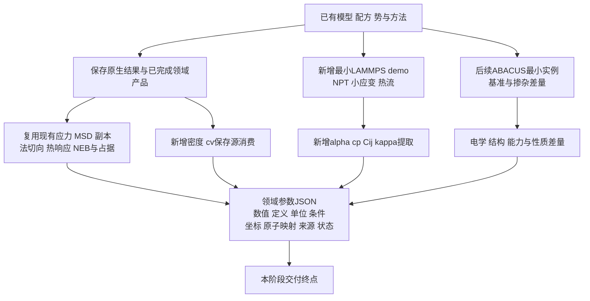

2026-10-26最终状态：本计划J1–J6已完成领域JSON及同Study的首次工程交付，启用0.57、回退0.56、源码冻结0.57；最后缺项由job633完成，无重复原生/解析/算法验收。完整逐项job与科学未决见[阶段交付报告](../workspace/reports/domain-json-stage-completion-v001/report.md)。下文队列和分工为执行前历史，不再构成新计算范围。新增DFT仍time=0/SCF1e-11；有限墙钟仅用于非DFT任务。

# 领域参数 JSON 阶段开发计划

2026-10-26 用户最新范围：基于已有多尺度流程图推进缺失能力，当前交付终点仅为领域参数 JSON：数值、定义、单位、条件、坐标、原子映射、来源、状态。系统功能优先，每项只跑新增路径的最小 demo。每小时监督一次，有实际交付或需要处理的阻塞再汇报。

本计划收束 `multiscale-parameter-computation-transfer-v001.md` 的当前执行范围。下游 SI 通用转换、陶瓷均匀化、场投影、COMSOL/其他有限元适配、器件求解后置；已有出口保留，不扩展、不重验。领域内计算所需单位、符号、坐标及映射处理仍直接传递，不能改变数值含义。

## 完成依据

- 一个实际可调用入口，明确请求文件，读取保存源或运行最小新增 LAMMPS 协议，输出有数值或原生失败/未决状态的领域 JSON，并可由既有 Study 消费。
- 新增功能完成一次“请求→实际执行或保存源消费→领域JSON→Study”的最小demo，即记为功能具备并推进下一项；后续数值好坏不触发重复验收。代码完成但尚未执行demo的功能，按“待首次运行”记录。
- 不追材料数值、收敛精度、稳定性、生产资格或漂亮曲线；这些不作为开发停止条件。原始失败与未收敛状态随结果保留，不据此自动追加计算。
- 不增加哈希、校验和、文件摘要、内容缓存、全对象身份比对、资格门、反复环境核查或独立验证框架。只修阻断实际输入输出的错误；仅检查新增路径不可缺少的字段、单位和映射。
- 不重跑旧原生计算或已经通过的检查；每个新增功能一个最小 demo，相关消费合并验收。局部失败只修失败节点，续接未完成步骤。
- 真实输出不伪造；工程示例与原生计算分开标识。数值验收和新模型生成仍通过 v100 Slurm，先声明有限预算，不接管共享环境或上游。

## 当前已完成的起点

561–564 的 CZO host20、势146、300/400 K 两 seed NVT 已完成。565 的八项新增检查及四份原生解析已通过；复制后势路径导致的 workflow 身份误判由主线修复，566 已完成十二份同 Study 消费。唯一安装567已COMPLETED/0:0并启用0.54，不重做本批计算、解析或安装。

法向/切向受载、界面热响应、应力、MSD/副本、四卡 NEB 和占据分析已有功能直接复用。候选 NEB 势垒和未收敛状态照存；不追 NEB 收敛。多掺配方、随机占位、外部 SQS 导入及保存物性比较已有入口，不重新开发。

## 有序交付清单

| 批次 | 实际补充能力 | 最小 demo 与结果 | 主要分工 |
|---|---|---|---|
| J1，立即 | 保存结果到中立领域 JSON；密度、定容比热区间 | 复用561–566保存的模型质量/体积、PE+KE、实际温度与统计窗；输出密度与cv区间产品。现有应力/MSD/副本/NEB产品各按实际需要薄接，不重解析旧轨迹、不重跑领域算法 | 规划定JSON约定与独立薄出口；原实施负责bulk统计及公共CLI/Study串行接线 |
| J2，与J1并行 | NPT输入/输出、热应变、热膨胀与定压比热区间 | 复用同CZO模型和势，两个温点、每温点一个seed的有限NPT demo；保存胞矩阵、温度、PE+KE、体积、外压与时间窗，输出rho、热应变、alpha、cp区间。只首次跑该新路径，不扩大温度/副本矩阵 | 第三负责原生writer/parser薄增量；原实施在J1交回后接消费者；规划一次确定协议/资源 |
| J3，J2后 | LAMMPS完整弹性张量到领域JSON | 一个既有小模型、一组六方向正负小应变，复用现elastic数学及既有应力读取，输出完整Cij、参考应力、分量顺序与边界定义；仅一组工程幅值，无精度扫描 | 规划短协议和文件所有权；第三输入/读取，原实施消费者 |
| J4，J3后 | 体相热流、体热导及界面热响应参数 | 一个方向的最小bulk NEMD输入/输出到J、温度梯度及kappa JSON；界面先复用458/462输出实际胞级热响应，需要单界面G/R时显式写分流/面积/温差参数并做一个新增demo，不按未声明的除2假设补数值 | 复用现热浴与温度表实现，第三原生，原实施消费 |
| J5，复用及补薄出口 | 法/切向曲线、应力、MSD/副本、迁移势垒/占据统一消费 | 保存领域产品到JSON，不重跑529–534、546–551、561–566。保留净胞/单界面、时间轨迹/NEB图像等定义；每种已接通产品不重复验收 | 规划明确需要的适配，原实施公共接线 |
| J6，LAMMPS优先批后 | ABACUS及基准/掺杂差量到领域JSON | 复用介电、Born、电子与性质对比；按已授权自主工程选择完成BTO host/Dy/Ho最小输出。新耦合函数只按实际缺口逐项补，首轮不铺完整Born/Gamma或精度矩阵 | 规划方法/清单/集成，另两窗口按明确独占文件配合 |

J3/J4是当前开发队列，不要求等待科学判据通过；主线按交付和资源逐项续接，不等监督下次轮询。新增数值协议各自先声明CPU/GPU/内存/步数或迭代上限/有限时限。没有新增路径需求时不再计算。既有数据缺字段时，只补该路径必需的新输出，不重建来源框架。

## 第一批文件所有权

- 规划：JSON字段约定、最薄独立 `domain_parameters.py`（若已有等价入口则复用）、方法/预算/最终集成与活动计划头部。不在此模块执行原生计算、重解析或增加全局验证器。
- 原实施：新 `bulk_thermodynamics.py` 或现有等价bulk模块的最薄扩展、该模块新检查，以及CLI/property_delivery/Skill唯一串行接线。先J1密度/cv，J2原生交回后再接alpha/cp。不得覆盖第三的writer/parser。
- 第三：当前安装收尾后，新 `lammps_bulk_thermal.py` 及对应专属新增检查；通过现有LAMMPS writer/task hook接NPT，必要共享文件由规划明确单一所有者。复用runner，不重造调度器，不改原实施公共消费文件。
- 所有名称由规划按实际源码布局复用/简化；三方都有他人并行工作，不回退或覆盖他人的改动。冻结批次交回后再改共享文件。

## 小型JSON交接

复用既有Model/TaskRecord/Result/Study身份。一个领域schema版本与软件版本分离，不建立大型全域schema注册系统。

```text
schema_version, kind, model_id, study_id
properties[]:
  name, value 或 data_ref, unit, shape, definition
  conditions, coordinates, atom_mapping_ref, source_refs, status
execution: job_id, state, exit_code
```

引用采用已有模型/任务ID和文件路径；路径可随传输改变，不使用哈希或全对象相等证明身份。坐标/映射不适用时写明不适用，不强造原子级字段。大数组留原文件，通过具名引用传递。新增参数允许扩展properties，不要求修改其他领域算法；后续模块只读取所需具名参数。保留小的显式函数调用，不搭插件、来源总线或DAG系统。

## 当前截止流程图



本阶段不开发K之后的尺度等效化、网格映射或有限元求解；也不以这些后续能力或材料精度作当前验收前置。
