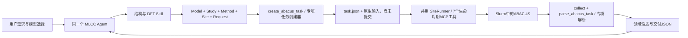
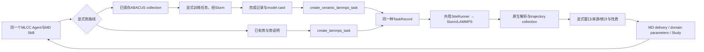

# DFT / MD 的实际组织与统一对话入口

2026-10-28；基于 `mlcc-agent-kit@b5cbc711211dd78d37beb7e7aecb00882cb4bb97` 的源码审阅。

用户已明确最终目标：**一个对话框调用 DFT、MD、相场、RVE、FEM、SPICE 各尺度计算能力**。本轮做前期准备，不另做一套聊天产品，不实施新科学模型。

后续补充：[光刻胶架构对照与合理调整](photoresist-comparison.md)。同事已经有Zeus原生对话接入与能力保全计划；本报告的请求入口可经该宿主的受控脚本或具名工具承载，不预设必须新增MCP。公开仓库没有提供私有宿主源码，当前只能审阅其接入报告，尚未在本机复验。

## 1. 对方已经是一个 Agent 加多个能力

`mlcc-agent/bundle.json` 只声明一个 Agent `mlcc`，入口 `agents/mlcc/AGENT.md`；它挂载四个 Skill：结构建模、DFT、性质计算、MD。不是每个尺度一个独立聊天窗口。现有框架符合统一对话的方向。

但 Skill 不是执行器。实际科学操作在 Python 领域函数/CLI，作业控制在 `SiteRunner`，对话宿主负责加载 Bundle、授予工具和连接模型。公开源码和历史宿主报告不等于本机已经安装/连通了该宿主；本轮没有启动在线会话。

还有一处接入前必须处理的旧边界：当前 Agent 文本明确写着“有限元、铁电/断裂相场、完整器件电磁不在本版工具范围”。导入我们的代码后，必须连同 Agent 的范围、可调用操作和 Skill 一起更新，否则统一对话仍可能按旧规则拒绝。不能只改一句话就宣称新能力可运行。

## 2. DFT 的实际调用链

- **输入角色分开**：Model 提供结构/原子身份，Study 绑定材料、相、model ID/version，Method 选择 ABACUS 版本、PW/LCAO、赝势/轨道、电子设置和数值参数；Site 只提供站点资源与实际路径；Request 给 calculation、资源、依赖和 task ID。
- **创建器不是运行器**：`abacus_tasks.py:create_abacus_task` 读取这五类输入，核对 Study/Model、charge、method/resource 等关系，生成 `INPUT/STRU/KPT` 等输入、`method.json`、`run-abacus.sh` 和 TaskRecord。返回 `status=defined`、`scheduler_job_id=null`、`scientific_status=not_calculated`。
- **共用任务结构**：TaskRecord 保存 engine/version、model/version、method_set、required_results、command、environment_script、transfer_paths、collect_paths。领域元数据保留在任务里，runner 不实现 DFT 方程。
- **基础与专项分开**：基础 `create-abacus` 处理 SCF/固定胞 relax；Berry、应变、声子位移、缺陷等由专门创建器与解析/后处理函数连接，共用 Task/Study 和 Slurm 生命周期。不能用“支持 DFT”推导所有性质都完整。
- **完成与收敛分开**：`parse_abacus_task` 先要求保存的原生调度完成记录，再解析原生结果；`results.py:make_dft_result` 核对 task/Study/工况、来源和科学状态。`property_delivery.py` 交付具体性质，设计评估单列。

关键入口：`abacus_tasks.py:67,298`、`results.py:make_dft_result`；专项代码包括 `berry_tasks.py`、`phonon_tasks.py`、`defect_tasks.py`、`elastic.py`、`dielectric_response.py` 等。这些是源码能力定位，不是本轮新增科学验收。

## 3. MD 的实际调用链

- **通用 MD 创建**：`lammps_tasks.py:create_lammps_task` 接受 Study、Model、Potential、Protocol、Site、Request。Potential 明确势文件、元素顺序、模型适用范围/资格；Protocol 明确 run0、MD、界面等操作及采样设置，不能仅凭用户说“跑 MD”猜势和工况。
- **可复用的运行层**：生成 LAMMPS data、输入、原子映射、势来源与 TaskRecord；仍返回 defined/null job。随后走与 DFT 同一套 prepare/transfer/submit/query/cancel/collect，不是另起一个 MD 调度系统。
- **自训练路线是显式分支**：`ceramic_potential_route.py:create_selected_ceramic_task` 要求 `potential_route=abacus_deepmd` 且 operation 明确为 create_training 或 create_lammps。前者复用 `ceramic_training.py`，后者复用 `ceramic_md.py`；底层数据/训练/推理由 `standalone/deepmd_bridge` 接口支撑。不会因模型缺失自行启动训练，也不是每次 MD 都先训练。
- **轨迹与统计解耦**：原生解析后，`md_trajectory.py:read_md_collection` 保存 thermo/轨迹和模型、势、job 身份；`md_conditions.py` 读取显式窗口；MSD、RDF、replica、局部应力、热响应等分别消费真实保存来源。run0 不是动态 MD，NEB 图像不是时间轨迹。
- **对外是交付产品**：`deliver-md` 和 `property_delivery.py` 将状态、条件、数值、来源接回同一 Study；`saved_domain_parameters.py` 可将已有产品转成 `mlcc.domain-parameters.v1`。输入完整/任务完成不等于势与采样已获得科学资格。

关键入口：`lammps_tasks.py:199,437,595`、`ceramic_potential_route.py:77`、`ceramic_md.py:278,532`、`md_trajectory.py:234`、`md_conditions.py:243`、`property_delivery.py:deliver_md_properties`。

## 4. 统一对话目前还缺什么

现有 MCP **只有 7 个任务生命周期工具**：list、prepare、transfer、submit、query、cancel、collect。它们操作已有 TaskRecord；`prepare_calculation(task_id)` 是写 batch script，**不是**根据自然语言创建 DFT/MD 专业请求。已有领域创建和交付主要经 CLI/函数；公开 Bundle 本身没有把所有科学 CLI 参数变成对话结构化工具。

因此，统一对话接入不能停在“给 Agent 多挂四个 Skill”，也不能让 LLM 任意拼 shell 命令替代确定性专业校验。建议下一阶段补一层明确的能力路由与专业请求创建入口，复用现有运行层。具体工具名称和字段仍为提案，尚未实施：

| 对话侧动作 | 确定性宿主负责 | 返回对话的事实 |
| --- | --- | --- |
| 发现/选择能力 | 列出实际可调用的尺度/operation、输入 schema、限制与当前部署；保留已有DFT/MD入口 | 能力、可用性、缺项，不把方法推荐当成执行 |
| 准备请求 | 验证明确输入/引用、Study/Model身份，生成可审阅专业请求；DFT/MD走各自创建器，四模块走自身schema/preflight | 输入摘要、缺项、预检、资源与执行草稿 |
| 明确提交 | 宿主按授权调用一次既有任务生命周期，关联平台/模块/Slurm身份 | 真实task/job ID与状态 |
| 查询/取消 | 调用现有runner；四模块的取消需新增桥接对账语义 | 保存状态/真实调度状态及取消确认 |
| 读取/解释 | 只读已保存结果与注册产物，绑定同一任务；保留数值/科学/设计状态 | 原生证据、QC、限制与文件引用，不重算 |

DFT、MD、相场、RVE、FEM、SPICE 应作为**同一个 Agent 可选择的能力**。它们可以对应多个进程/环境；用户继续在同一个对话里请求计算、查询和追问，不需要切到不同尺度的聊天窗口。多尺度之间自动传参是另一项能力，不能从同一对话入口自动推定已经完成。

## 5. 推荐的合并顺序

1. 保留同事唯一 Agent 与平台壳，核对实际宿主的工具调用与授权方式；不另部署一个常驻对话 Agent。
2. 在集成分支隔离导入我们的完整计算包，解决同名 `mlcc` 包/CLI；DFT/MD继续使用对方现有环境和创建器。
3. 先将“能力发现 → 专业请求 → 预检 → 明确提交 → 状态/结果 → 同会话只读追问”做成一个端到端切片。首例可从已有四模块中选一个，不新增科学内核；实际操作待实施时明确。
4. 补四模块的路由/Skill和平台结果交付，逐项加入能力清单；保留DFT/MD旧入口与任务读取回归。
5. 集成验收必须增加**同一会话跨尺度切换**：先读一个已有DFT/MD结果，再切换一个连续介质操作；task/模型引用不串用，查询不重算，科学参数不从前一尺度隐式继承。随后逐尺度覆盖。
6. 如确有上游参数消费需求，再为具体 DFT/MD property → 具体模块输入建立显式适配，保留单位、坐标、reference state与原始资格；不把完整六尺度链硬编码成必经流程。

本轮结论：对方 DFT/MD 的共性是“一个Agent/四个Skill、领域创建器、共同TaskRecord/Slurm、领域结果/Study交付”。我们的接入应扩展这条结构，同时保持独立科学环境和确定性执行，不用目录拼接冒充统一对话完成。
