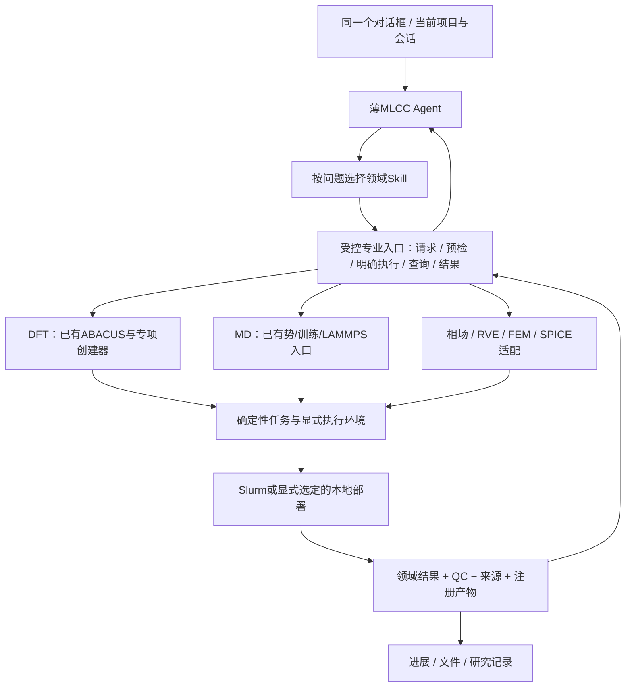

# 光刻胶参考、同事平台与统一多尺度架构取舍

2026-10-28。用户明确：合理需求可以调整架构，并要求参考原光刻胶 Agent。以下依据实际文件，不将旧项目约定冻结为新集成的硬边界。

## 已找到的继承依据

同事仓库 `docs/harness-design.md:11` 明确写明“架构主要参考 Photoresist-agent-kit 的薄 Agent、持久科学任务、阶段交接与收集后验收”；两版详细执行计划书也说明同一关系。这确认了设计参考关系，不等同于已经证明 Git fork 或所有代码来自同一版本。

优先继续参考同事现有的 `docs/zeus-mlcc-reuse-and-module-plan-20261027.md` 和 `plans/mlcc-capability-migration-20261027.csv`。前者第0节报告原生对话、安装能力绑定及一次真实只读工具闭环已完成；较早的 `zeus-dialogue-entry-v001.md` 仍有 provider 待定文案，应按时间和证据区分，不能只引用较旧状态否认后续进展。以上是本次读到的交付报告；真实运行产物未包含在公开仓库，本机未复验宿主。

同事已经维护107条CLI命令的静态迁移账本，并报告25类交付来源、4 Skill、7 MCP及独立势入口。该账本能作为保全索引，不能把 `not_started` 批量升级为已接入对话，也不能只凭入口数量判断行为兼容。新四模块接入时应扩展已有账本，避免建立互相漂移的第二本能力总账。

## 三套实现的对照

光刻胶参考根为本项目只读 `reference/Photoresist-agent-kit/bundles/arf-car-computation/`；以当前 `bundle.json`、`ARCHITECTURE_V3.md`、Agent、固定脚本源码为准。V2已废止，V3末尾仍有与现行manifest不一致的旧MCP验收文字。

| 层 | 光刻胶当前实现 | 同事 MLCC | 我们已有实现 | 集成方向 |
| --- | --- | --- | --- | --- |
| 交互 | 单 Agent，宿主承担会话、工具/脚本与产物展示 | Zeus 原生 AgentThread/SSE；私有宿主有接入报告 | 受控CLI AgentHost与会话记录 | 一个主对话；复用实际宿主，不为每尺度再建聊天前端 |
| 路由 | 按问题选择当前所需Skill，不预读全部方法 | 一个Agent挂四个领域Skill | 选定module/operation后加载专业契约 | 扩展为六尺度能力路由，按需读Skill；不把所有方法塞进一个大prompt |
| 模型调用出口 | 领域固定 `scripts/calculation.py`、`md.py`，公开MCP为空 | 专业CLI/函数 + 7个生命周期MCP | 标准JSON子进程Adapter | 采用当前宿主支持的受控脚本或具名工具；传输形式服务于能力，不能认定统一对话必须新增MCP |
| 任务执行 | 持久短号、宿主独立Worker/dispatcher推进 | TaskRecord + SiteRunner + Slurm | Runtime queued + 显式worker | 统一用户可见任务句柄与来源，明确谁负责提交/推进；不同时运行两套同义调度器 |
| 交接 | 科学source短号、具名角色；程序解析真实文件 | Study/model/version/task + 领域JSON | 模块专业输入/结果/注册产物 | 以身份/引用传递，程序解析数据；LLM不搬坐标/数组或猜文件路径 |
| 结果 | 摘要、available_keys、按需分页；摘要不作下游数据 | 领域Result/Study/domain parameters与保存查看器 | execution + numerical/scientific QC与原生产物 | 统一摘要/详情/产物索引，保留原领域结果和原始状态 |
| 验收 | Harness覆盖正常/缺项/失败/拒绝与真实算例 | 原有各领域与宿主独立证据 | 公共119项 + 四模块分层验收 | 新入口增量验收、旧能力兼容、同会话跨尺度切换；不靠静态页面代替真实调用 |

光刻胶脚本实际位于各Skill的 `skills/<skill>/scripts/`；公共calculation实现为 `skills/calculation-routing/scripts/calculation.py`，不是Bundle根的 `scripts/calculation.py`。`mcp-servers/` 中存在内部内核不等于对外发布MCP。

## 架构可以怎样调整

此前隔离目录方案是首个可审阅迁移切片，**不是最终架构必须保留两套运行框架的决定**。合理的公共层调整、包命名整合、协议适配和旧宿主替换均可提出并在集成分支实施；科学内核继续复用已有成果。

建议的目标层次：

优先调整的内容：

1. **统一专业请求入口**。复用光刻胶固定脚本的思想，将科学请求与模型/结果引用变成受控调用；创建、执行、查询、读取的副作用边界明确。已有DFT/MD创建器接到该入口，四模块保留专业schema。接口可经原宿主的脚本能力或新的具名工具暴露，具体取决于私有宿主实际接线。
2. **统一能力描述与返回视图**。用户能发现六尺度、具体operation、必需输入与当前可用性；结果统一提供摘要和原生详情引用，仍保留各模块QC/失败/未收敛/null。公共 `mlcc.domain-parameters.v1` 适合物性与汇总，不要求所有场/网格/轨迹都塞入同一schema。
3. **统一任务关联与授权**。建立项目/会话、Study/领域任务、Slurm job的显式关系。一个对话可操作多任务，不把“当前尺度”当作数据归属；明确授权范围，范围内不重复确认，读取不隐式提交。
4. **处理包和运行层重叠**。两个Python包都叫mlcc。首切片可用独立进程隔离，长期可把我们的运行子包改为无冲突命名，或将公共功能整合进平台；依据真实兼容性和迁移成本选择。不能同环境安装后依赖import顺序。
5. **完整模型类型**。DFT/MD是原子模型，FEM/RVE/相场用几何/网格/区域，SPICE用电路与端口。统一引用与版本，不伪造atom ID或强塞进DFT模型。参数转换单独声明坐标、单位、参考态和来源，不在LLM或前端里计算。

后台推进是否需要新增服务，以统一对话长任务的真实需求决定。可以调整现有执行架构，但先核对同事已有Slurm生命周期与宿主进展合同，复用足够部分；不为了外观一致搬整套光刻胶dispatcher。光刻胶的分子力场默认值、固定副本数、自动数值修复/重试和化学专属门禁均不直接迁入MLCC。

## 公开仓库没有包含的关键交接物

同事计划把实际工作台改动定位在 `workspace/runtime/matterai/`，包括server、web、模型运行时、任务/Study查看器和配置；公开仓库忽略 `workspace/`，本次clone没有该宿主源码。真实截图/会话/验收也引用私有workspace路径。

这不阻塞源码学习和计算模块合同准备。进入实际统一对话开发时，需要取得该私有宿主的可修改源码/版本和启动方式，或明确采用另一现成宿主；不能把本仓的 `scripts/platform/` 探测脚本当成完整聊天平台。模型配置和凭据继续由宿主管理，不迁入公开分支。

同事原方案的首个后续FEM方向是COMSOL；我们的已有后端是FEniCSx、ngspice。应在新接入能力清单中明确声明实际后端和能力范围，不能让模型按旧计划自动选择COMSOL，也不为贴合旧架构重写已完成的内核。

下一阶段建议以“已有DFT/MD入口保留 + 一个新尺度真实接入 + 同会话切换与只读追问”作为第一个端到端切片，再扩展六尺度。合理架构变更按实际需求进入分支，验收后再PR/merge。
