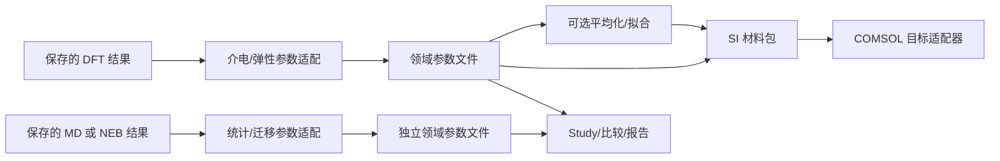

# MLCC 阶段 JSON 交接与最小模块化方案

日期：2026-10-26。性质：对现有源码和保存交付的评估；下述新合同为提案，尚未实现。主线负责本文件，原实施窗口核查 Study/公共消费，第三窗口核查 SI/COMSOL，Luna 核查 Model/Task/Result/Study。没有新增 DFT、MD、NEB、训练或参数优化。

## 1. 结论与实际交付

现有架构已经能通过文件连接独立步骤。需要补的是稳定的领域参数入口、明确的 artifact 引用和少量公共分派，不需要另建 runner、插件框架、来源总线或微服务，也不应把项目固定成 DFT→MD→有限元的单链。

氧空位结果已经交付到同一 Study `czo-vo8-q0-energy-chain-v001`：

| 保存交付 | 实际内容与状态 |
| --- | --- |
| `workspace/reports/vacancy-migration-v001/geometry-consumed-549/neb-delivery.json` | `responses.vacancy_migration.source_record.native_result.barrier` 保留正向 2.2745886 eV、反向 2.4586354 eV；最高最终图像为零基序号 1。四图像、原生停止原因和各阶段收敛状态均在；regular/climbing 达到迭代上限，`native_converged=false`。 |
| 同上 `responses.vacancy_migration.site_changes` | 保存一次内部相邻图像的 O14→8 几何变化；端点位点归属仍未决。NEB 图像没有真实时间，不能解释为自发跳跃或速率。 |
| `workspace/reports/vacancy-migration-v001/checks-544/saved155-delivery.json` | 六帧 MD 的 `responses.vacancy_migration.jump_events=[]`；表示这段 0.5 fs 工程轨迹未观察到跳跃，不证明没有迁移或扩散。 |

未发现 Study 内容遗漏，不重跑 542–549。另发现独立的软件缺口：`workflow.inspect_task` 原先将全部 LAMMPS 结果送入仅支持 run0/MD 的规则，NEB 已保存结果被续接建议误报为缺证据。修复已通过 job550（COMPLETED/0:0，1 秒）的 3 项新增检查及真实保存任务 public resume-plan。随后 job551（COMPLETED/0:0，2 秒）仅检查安装绑定并调用一次保存任务 resume-plan，通过后已启用0.53，回退0.52；源码进入0.54。Python/MCP/Bundle实际入口一致。没有重复550测试、原生解析或NEB；task/result文件未改动，物理状态保留。证据在 `workspace/reports/modular-stage-handoff-v001/integration-v053/release-acceptance.json`。0.51三个精确纯软件副本已退役，科学证据和共享环境保留。

## 2. 已有解耦与具体耦合

代码路径均相对于 `mlcc-agent/src/mlcc/`，函数名是后续修改定位入口。

| 边界 | 已有实现 | 目前新增模块的成本 |
| --- | --- | --- |
| 模型 | `modeling.py:ModelArtifacts/read_model_artifacts/write_model_artifacts` 分离结构、JSON 元数据、稳定 atom ID、父映射和晶胞变换 | 路径/来源引用格式不统一；不是每种模型写入器都采用相同父模型引用。不能据此自动补造父系。 |
| 执行 | `tasks.py:TaskRecord` 保留领域扩展字段；`site_runner.py:prepare/transfer/submit/query/collect` 使用明确 command、resources、transfer/collect paths | 新领域创建器可复用 runner；不需要给 runner 增加材料分支。TaskRecord 不是完整领域 schema 校验器。 |
| 结果 | `results.py:make_dft_result` 已分离 scheduler/scientific_status/design_assessment；各领域也有独立版本 schema | 通用 DFT Result 不是全部领域的基类；领域状态、单位和来源布局仍不同。不要强迫把所有结果改成 DFT Result。 |
| Study | `studies.py:load_study` 和 `property_delivery.py:deliver_*` 保存任务选择、条件、绑定及结果 | Study 是普通 JSON Mapping；较早温度辅助函数要求 temperature_protocol，不能把它变成所有新步骤的必经入口。 |
| CLI | `cli.py:build_parser/main` 显式注册参数并 if/elif 分派 | 新命令通常要改参数注册、handler；新 Study 产品还要改 deliver-properties 参数与分派。可用普通登记表减少接线，不能宣称现在已自动插拔。 |
| 续接与依赖 | `workflow.py:inspect_task/require_result_dependencies` 是只读建议和显式依赖检查 | engine 分支集中且只识别部分领域；旧 required_results 只接受 converged 类状态。不能把这套专门依赖规则直接套到全部保存后处理。 |
| MCP | `mcp_server.py:build_server` 七个工具封装任务生命周期；`tools/mlcc_mcp.py` 仅启动器 | 领域模块沿现有 CLI/Skill 入口接入时无需逐个增加 MCP 工具。只有明确要暴露新的工具能力时才改 MCP/Bundle。 |
| 交付 | `property_delivery.py:deliver_vacancy_migration` 校验 Study/model，保留完整产品；`vacancy_migration.py:_neb_saved_frames` 消费保存结果 | 下游若取势垒仍需知道 source_record/native_result 内部路径，容易跟着上游结构变动。应在边界增加参数适配，而非要求上游所有 parser 改格式。 |
| SI/COMSOL | `continuum_parameters.py:build_continuum_parameter_package` 已有 SI、张量旋转、静态/温度表、来源；`comsol_export.py:export_comsol_material_package` 是目标格式出口 | SI 核心包含 `comsol_global_cartesian`、`comsol.permittivity_property`；`_extract_source` 集中识别几种上游 schema。COMSOL 名称/Java API/tag 应留在目标适配器。 |

COMSOL exporter 对坐标的校验与 SI builder 不完全一致，属于合同分散和未来漂移风险，尚未证明本次真实路径错误。现有 COMSOL 原生导入未执行；不为本次评估重新探测环境或导出。

## 3. 最小交接合同

保留现有领域 `schema`（例如 `mlcc.lammps-neb-result.v1`），在模块边界添加小型 request/result 参数合同。**JSON 文件格式本身不保证可替换；字段含义、版本、单位和允许状态才是合同。** 新领域各自定义合同，公共部分只复用必要字段。

| 项 | 最小约定 |
| --- | --- |
| 身份与版本 | `schema` 标识领域及主版本，另保留 producer 软件版本。schema 版本与软件发布版本分开；读者明确支持哪些版本，不猜测、不静默升级。旧 v1 继续可读；含义/单位/必需字段的破坏性改变建立 v2 和显式适配。 |
| 请求 | `operation`、`study_ref`、`model_refs`、具名 `inputs`、`parameters`、输出位置；条件/资源只有该步骤需要时才提供。参数显式选择，不继承“最近任务”、默认材料/相或其它窗口的隐含状态。 |
| artifact 引用 | 每个引用保留 `path`、`schema`（适用时）、`role`，以及已存在的 model/task/job 身份；子字段选择器仅由适配器使用。相对路径以声明的包目录为根；远程路径带 site 与位置说明，本地副本是另一个位置，不伪装成同一路径。 |
| 结果 | `schema`、`study_ref/model_refs`、小型 `properties`、`artifacts`、执行/数值/来源状态；引用实际源文件与解析记录，原生结果继续保留，不把摘要当成唯一科学证据。 |
| 物理量 | 每项有 `quantity/definition`、`value` 或 `data_ref`、`unit`、`shape`、`conditions/reference_state`、`availability`、数值状态及原因。缺失为 null 加原因；零是测得/算得的数值，两者不能混用。 |
| 坐标与原子 | 张量声明 frame/basis、分量顺序、适用的旋转矩阵/Voigt 顺序/engineering shear；结构量绑定 model/version、stable atom ID、映射、PBC 和晶胞。适配器只做一次明确转换，不暗中重排或旋转。 |
| 工况 | 静态 DFT、热浴/采样温度、烧制范围、测量温度分别声明；方法/场/应变/电荷等按量的需要绑定。SCF 1e-11 不是 Born/Γ 或 NEB 的单位化阈值。 |
| 大数组 | 轨迹、力常数、逐原子张量、逐模数组留在现有文件，JSON 只放引用、shape、unit、索引/映射及格式。优先复用已有 CSV/NPY/原生文件，不新增数据库或哈希缓存，不把完整轨迹层层嵌套复制。 |

一个后续模块应读取 `properties.migration_barrier_forward`，而不是熟悉 `source_record.native_result.barrier.forward_eV`。示意输出如下，**不是当前已经提供的 API**：

```json
{
  "schema": "mlcc.migration-parameters.v1",
  "study_ref": {"study_id": "czo-vo8-q0-energy-chain-v001"},
  "properties": {
    "migration_barrier_forward": {
      "quantity": "migration_energy_barrier",
      "definition": "native_final_NEB_forward_candidate",
      "value": 2.2745886,
      "unit": "eV",
      "shape": [],
      "availability": "available",
      "numerical_status": "unconverged",
      "qualification": false,
      "conditions": {"mode": "neb_path", "time_ps": null},
      "source_ref": "native_neb"
    }
  },
  "artifacts": {
    "native_neb": {
      "path": "native/result.json",
      "schema": "mlcc.lammps-neb-result.v1",
      "role": "native_parsed_result",
      "task_id": "czo-vo8-nearest-neb-v001",
      "scheduler_job_id": "546"
    }
  }
}
```

`native/result.json` 仅为可移植包路径示意，实际导出必须明确复制或绑定到真实 artifact；不能写一个并不存在的路径。

## 4. 状态、可替换步骤和显式依赖

保留四个不同问题：任务是否执行完成；参数是否有值；该参数是否数值收敛/位点确定；是否有用途资格。设计达标评估继续独立。`COMPLETED/0:0`、`available` 和 `converged` 不能互换。

当前 SI 层用非 null 判为 available，源 status/qualification 仍在 source 中；COMSOL 层可据 available 导出。这没有丢证据，但消费者容易误读。最小改进是在参数出口显式带出原 convergence/qualification/reason，工程导出允许带标记的未收敛数值，不增加材料资格作为系统开发门槛。后续科学计算是否接受此输入由其领域合同说明，不悄悄抬升状态。

流程按请求选择的产物依赖连接，可以分支、合流、跳过不适用步骤：



NEB 势垒并非 COMSOL 材料常数或扩散系数；将来插入动力学模块时，要另外声明温度、尝试频率、跳跃网络/假设等真实输入。现在不生成这些数值。

每个步骤列出具名输入 role、接受的 schema/主版本、模型/方法关系和需要的状态。仅检查本步骤真正依赖的产物；导出/报告可以消费完整但未收敛记录，要求物理收敛的计算不能接受它。缺必要输入则返回缺项；可选输出留 null；独立分支不等待整个 Study 全成功。Slurm 的调度依赖与产物物理条件是两层，不用 afterok 代替物理判断。

替换或插入模块时，显式改变下一步引用的 artifact；同一参数合同可由不同来源适配器生成，但必须保留 engine/method/model/condition，不能因为 schema 相同就混用 VASP/ABACUS 总能或不同电荷/几何的参数。

## 5. 建议实施顺序与改动范围

1. **实际 NEB 续接建议缺口已修复并启用。** 仅 `workflow.py` 和专门新测试；550复用546保存结果，551只补安装入口，工程完成/未收敛分离、错误身份/缺文件拒绝。此项不再重复验收。以下参数模块化仍为提案，未因这次安装展开重构。
2. **下次真正有新增消费者时建立首个领域参数适配器。** 可从 migration parameters 或已有 SI typed source 开始，保留旧产品，增加 adapter 函数与 request/result 示例。下游读取稳定 properties，源特有字段只在 adapter 出现。不要先搬迁所有历史产品。
3. **逐步缩小公共接线。** 当下一新增模块确实需接线时，用一个显式操作登记表记录 command/输入输出 schema/handler/交付函数；仍是普通 Python 函数、现有 argparse 和 runner，不动态扫描或执行 JSON 中任意模块路径。领域实现与登记项改变，现有解析器不动；没有必要时不新增 MCP 工具。未来领域续接规则按明确 schema 登记，旧分支逐步迁移，不一次重写 workflow。
4. **SI 与目标出口分离。** 沿用当前 `_extract_*`、单位/旋转函数，把源适配器移到边界；中性目标 frame 和 target request 取代领域包中的 COMSOL 专名。COMSOL Java/tag/属性名留在 exporter。静态值、真实温度表和插值/外推策略分别声明，不把一个静态值伪装成温度函数。保留 v1 兼容入口，只有破坏字段含义才升领域 v2。

待取舍：目前没有必须引入外部插件发现、JSON Schema 校验库、完整 DAG 执行器或新存储层的需求，建议暂不引入。结构验证以后可用共享小定义，但不能代替单位/物理条件检查。只有明确的新消费需求才扩展合同字段和运行验证；不要为“通用”预造所有能力。

评估完成标准是明确接口与最小改动，不以再发一个软件版本或重复计算代替功能推进。若后续实施参数适配，仅在 v100 Slurm 对新增路径做一次保存产品消费，保留原状态和来源即可；不重复本报告引用的科学计算。
