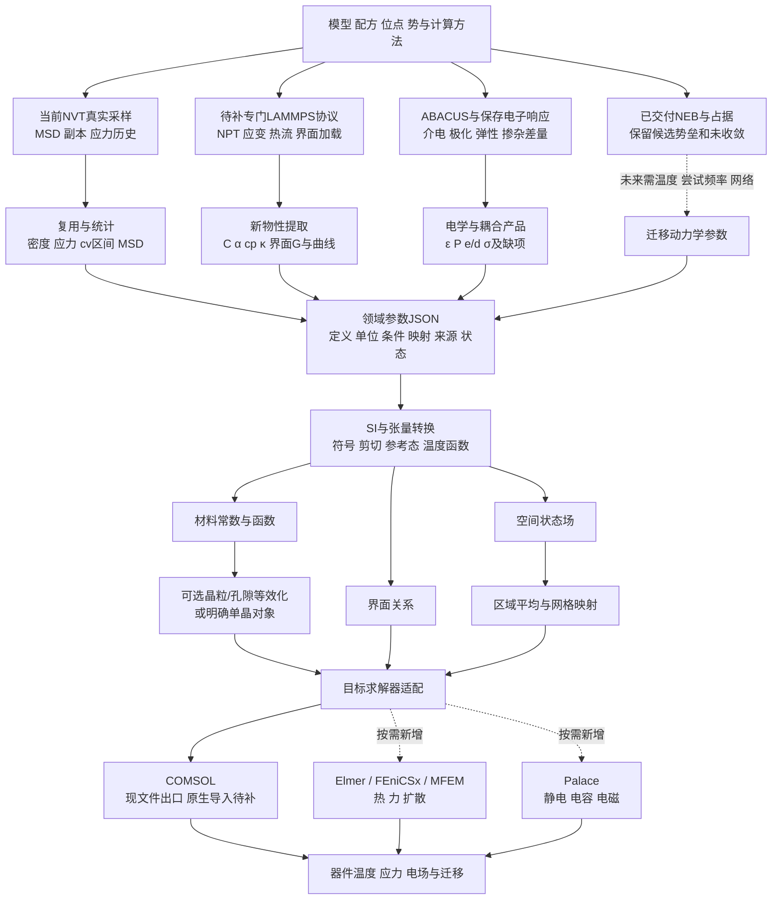

# MLCC 多尺度参数计算与转换开发路线 v001

日期：2026-10-26（Asia/Shanghai）。本文件是用户要求的后续计算与开发规划，不表示下列任务已经运行。依据“调研开源有限元软件GPU支持”聊天中的材料参数清单、`linux-fem-lammps-targets-v001.md`、当前源码及真实交付。保持当前 LAMMPS 批次执行；不重跑旧计算，不因本规划自动提交新的材料矩阵或安装求解器。

## 1. 当前差距与目标

当前已具备 Model/TaskRecord/Result/Study、Slurm、原生读取、介电产品、若干 LAMMPS 领域分析和 SI/COMSOL 文件出口。多掺输入、随机构型、外部 SQS 导入已实现。新批次正在准备/推进 CZO host20、势146、300/400 K各两个独立seed的固定胞NVT采样；实际作业状态以其协议和交接为准。

本次核实的具体缺口：

- `continuum_parameters.py` 有16类参数字段，但 `_extract_lammps` 直接支持的只有 `initial_stress`。其余字段可接受显式 typed source，不等于已完成各领域产品的适配或计算。
- 缺完整 LAMMPS 弹性、bulk 热膨胀/定压热容/热导 producer 及公共消费；现有 ABACUS 弹性函数不能当作已有完整非空材料表。
- 现 SI 核心仍要求 `comsol_global_cartesian`，应在下一真实适配增量中解除目标软件名称耦合；保留旧请求兼容。
- 空间应力映射、多晶/孔隙等效化、界面本构与目标网格的绑定没有因 JSON 文件出口而完成。
- 当前 NEB 势垒和 MD 占据分析均已到 Study；不把此项重新列为未实现。COMSOL 原生导入仍未完成，Linux 开源求解器是候选而非已接通目标。

目标是分别形成三种交付：**材料常数/温度表、界面关系、空间初始场**。它们按需要进入有限元，不能把所有原生输出都改名为材料常数。

## 2. 参数—计算协议—转换映射

| 参数与用途 | 当前状态 | 最小计算/取数方案 | 需要开发的转换与交付 |
|---|---|---|---|
| 密度ρ：惯性、传热 | 原子质量和胞体积已有；尚缺统一bulk统计产品适配 | 当前同模型轨迹按帧计算总质量/体积并统计；固定胞不会产生热膨胀密度变化 | 原子质量→kg，ų→m³；输出晶胞密度。器件体密度另带孔隙/相分数，不能直接等同 |
| 初始/局部应力及温差应力 | 全胞应力、DeepMD九分量与领域函数已有；新匹配历史采样正在推进 | 使用当前采样的压力张量与九分量，按明确区域/时间窗平均；同胞/同约束300/400 K差分 | 分清total/virial-only、压缩正/拉伸正、区域体积、材料坐标；状态场单独交付，后接空间粗粒化 |
| MSD、自扩散D与副本分散 | 软件已有；当前批补真实unwrap和独立seed | 氧原子展开坐标→MSD/拟合/两副本；仅在实际选定扩散段定义D | Ų/ps→m²/s；标明oxygen self、vacancy或charge transport种类。当前host20无氧空位，氧自MSD不能叫空位扩散；本批协议D仍null |
| 定容比热cv | 当前没有独立SI字段/领域产品 | 复用当前同V的300/400 K平均U=PE+KE，求区间差分ΔU/(mΔT)，连同两个副本的分散 | 新增cv的独立定义，输出区间估计与采样状态；排除thermostat累计做功，不能将cv填进cp字段 |
| 热膨胀α、热应变εth、定压比热cp | 缺bulk producer；固定胞NVT不能提供自由热膨胀 | 首批同模型同外压两个温点NPT，保存完整胞矩阵、U、V、H、实际T和P。以300 K为参考、400 K为目标；先工程区间，不扩扫描 | 同方向参考胞构造热变形/热应变，α为声明区间导数；cp=Δ⟨H⟩/(mΔT)，固定外压时H按U+p_ext V定义并保存原生enthalpy核对。共用源产出ρ(T)、εth、α区间、cp区间 |
| 完整弹性Cij：热应力/结构 | ABACUS静态分析函数已有；完整有效材料表及LAMMPS C(T)尚缺 | 单一温度、六个独立应变方向各±一个小幅值；用平均应力中心差分。起始工程幅值建议0.5%，不是精度扫描；零应变源仅在同参考/协议可比时复用 | 沿已有elastic分析增加LAMMPS adapter；完整6×6、参考应力、等温/静态、夹离子/内部弛豫定义、工程剪切与坐标转换→Study→SI。不能用夹持刚度替代Cij |
| bulk晶格热导κ | 缺producer；现Ni/BTO热响应不是bulkκ | 优先热浴能量收支NEMD，首批一种材料、一个方向、一个工程温度梯度；保存热浴累计能量与分箱温度梯度，κ=-J/(dT/dx) | 热功率/截面积→J；排除热浴区的梯度拟合，周期双向仅在明确对称几何时计双通道。单方向结果不伪装完整各向异性张量；Ni电子通道另计 |
| 界面热导G/面积热阻RK | Ni/BTO458/462真实热源已有，但空bin/瞬态/分流不明 | 先复用保存源输出可定义的胞级热响应。单界面参数需新增能辨认热流支路、界面位置及两侧外推温度的协议 | G=J/ΔT，RK=1/G；面积、界面数、方向和两侧温度定义随结果交付。不能对不等价双界面随意各分一半；需要时先交明确串联等效量 |
| 法/切向刚度、牵引—分离、分离功 | 真实小位移夹持/卸载链已通；现为双周期胞净响应 | 旧529/530、531–534直接复用。需单界面模型时另选一个可隔离界面及有限开口/滑移加载路径；完整损伤不由三点斜率生成 | 原始反力→明确对象牵引；相对位移→曲线；局部斜率Pa/m、路径积分J/m²。区分cell-net/单界面、刚度/损伤/耗散，保留加载顺序 |
| 表面能、晶界能、黏附功 | 有结构/能量与部分界面函数可复用，覆盖需逐实例确认 | 先消费匹配势/胞/应变/组成的保存总能；仅补实际缺少的参照态。非化学计量体系带明确化学势项 | 能量差按实际面积/界面数归一，eV/Ų→J/m²；黏附功与宏观断裂韧性分别命名，不重造已有结合能/化学势函数 |
| ε、P、压电e/d、电致伸缩 | CZO指定几何介电已有；BTO静态未决；完整耦合组未齐 | 现有ε先消费。后续ABACUS最小结构处理和Dy/Ho同方法对照；压电采用明确应变—极化响应及同边界弹性，不从普通E/F势生成极化 | 相对/绝对介电、高频/静态分开；P、ε、e、d、C同坐标/边界。必要时d=e·S，ε在固定应变/应力间转换需匹配耦合组，不能任意混源 |
| 电导σ、电子热导κe、损耗 | 已有σ/τ、κe/τ、Seebeck；τ缺失 | 先传有定义的归一化结果；真实σ/κe需显式散射时间或独立输运/实验源，损耗需频率模型/数据 | σ/τ不填S/m，κe/τ不填W/(m·K)；tanδ、复ε与电导损耗按同频率和谐波约定映射，避免导电损耗重复计算 |
| NEB→迁移率/空位扩散/离子电导 | 势垒和占据链已交付，NEB未收敛 | 不重跑546；未来独立动力学消费者需温度、尝试频率、跳跃网络及浓度。若来自自扩散的Nernst–Einstein估计，显式声明独立载流子与相关性假设 | 保留候选barrier及状态；几何图像不变成时间轨迹，不能仅用一条势垒自动填D、迁移率或σion |
| Landau、梯度、畴壁动力学系数 | 没有完整producer/拟合链 | 在真正选用铁电相场时，以可追溯文献系数作工程入口，后续用极化自由能、畴壁及动力学数据分别拟合 | 显式自由能多项式、P/能量密度单位、温度、机械边界、时间尺度；普通MD、单Γ或静态ε不能唯一确定这些系数 |

计算路线依据：[LAMMPS弹性](https://docs.lammps.org/Howto_elastic.html)、[热导](https://docs.lammps.org/Howto_kappa.html)、[MSD/VACF扩散](https://docs.lammps.org/Howto_diffusion.html)、[NVT/NPT](https://docs.lammps.org/fix_nh.html)、[热力学输出](https://docs.lammps.org/thermo_style.html)。热膨胀工作流可参考[atomistics官方LAMMPS示例](https://atomistics.readthedocs.io/en/latest/thermal_expansion_with_lammps.html)。这些是方法依据，线上最新版能力不代替本站二进制检查。

### 工程计算选择

1. 首版不追材料精度：先一个材料/一个方向或一组必要分量，保留数值及误差，不自动加时/加点/换势。
2. 当前四个NVT任务不改协议。cv和密度等新增统计等源交回后仅消费保存数据，合并一次新路径验收。
3. α/cp需要新NPT源，Cij需要新的应变源，κ需要新的热流源。这是不同物理问题的新增任务，不能称为复算旧MD，也不能隐含在export命令中。
4. 首版κ选择NEMD，可复用热浴收支功能，不依赖MACE缺失的逐原子virial。Green–Kubo作为以后显式选择的路线；即使已有DeepMD九分量，也还需匹配的逐原子能量、热流定义和采样，不能直接用九分量代替热流。参见[heat/flux](https://docs.lammps.org/compute_heat_flux.html)和[DeePMD热流说明](https://docs.deepmodeling.com/projects/deepmd/en/v3.0.1/third-party/lammps-command.html)。
5. 稀土/重元素的每个新势必须覆盖对应元素；当前Ca/Zr/O冻结势不用于BTO、Ni/BTO或Dy/Ho。保持已定BTO分别单掺的工程选择，先由ABACUS输出同方法性质差量；不因出口需求自动训练新多元素势。

## 3. 转换层的具体开发

### 3.1 单位、物理定义与状态

- 复用已有SI转换。补齐：Ų/ps→m²/s为1e-8；eV/Ų→J/m²为16.02176634；GPa/Å→Pa/m为1e19；总胞热容需除以总胞质量后才是质量比热。
- `units metal`长度Å、时间ps、能量eV、压力bar；bar→Pa为1e5。不要用其他unit style的系数。[LAMMPS units](https://docs.lammps.org/units.html)
- 原生压力压缩为正，Cauchy应力按拉伸为正；已转好的stress不再翻号。原子stress是应力×体积，区域平均需对应体积。保留9分量与virial-only/total；目标经典对称应力若需对称化，作为明确派生操作，并保存原张量及反对称部分。[原子应力定义](https://docs.lammps.org/compute_stress_atom.html)
- 新增cv、扩散tensor、界面曲线、能量面密度等独立property kind；不强塞现有16字段或将缺项改为0。工程completed与物性unconverged/有限采样是不同字段。

### 3.2 坐标、剪切与温度函数

- 明确Q定义为v_target=Q v_material。二阶张量Q A Qᵀ；弹性转换为四阶后旋转再打包6×6，压电按三阶处理。
- 原生六分量`xx yy zz xy xz yz`和工程Voigt`xx yy zz yz xz xy`分别处理；工程应变剪切为2εij，应力剪切不乘2。目标格式有自己的顺序时再映射一次。[COMSOL弹性排列](https://doc.comsol.com/6.3/doc/com.comsol.help.sme/sme_ug_theory.06.026.html)
- 两个温点产生区间估计或声明插值表，不称整个烧制温区本构。α切线/割线及参考温度、cp/cv、相与组分、预应力、热历史一并保存。不同材料/相/约束不接成同一曲线。
- 将COMSOL专属tag、字段名和坐标选项移到comsol_export，SI目标基改为软件中立的material/global_cartesian；旧请求用一个显式兼容适配，不搬迁全部历史结果。

### 3.3 原子/单晶到陶瓷层的尺度转换

新增一个薄均匀化入口，输入晶粒取向、相体积分数、孔隙、界面模型及对应材料参数。没有这些输入时可以明确采用单晶/致密单相工程对象，不默认为真实陶瓷层。

- 首版弹性可提供显式均匀应变/应力假设的上、下界和所选工程估计；非稳定/不可逆矩阵保留原值与失败，不自动投影成正定。
- 密度按体积分数混合；体积热容ρcp先混合再转质量比热。热导/介电可先交明确并联/串联界限，不能将其冒充任意微结构的真实等效值。
- 各向异性热膨胀与热弹耦合不能简单把不同晶粒α算术平均；在需要时采用机械相容的RVE平均或明确解析模型。
- 首版只做材料系数的等效化，不新增大型RVE求解框架；已有求解器可用时再接RVE任务和保存结果。

### 3.4 空间场到有限元网格

独立`field_transfer`职责：选定原子区域→时间/空间平均→物理坐标与单位→目标网格单元/积分点映射。首版先支持同一物理域的区域常量/分块场；检查积分量与总体均值是否保持，记录覆盖域和空区域。

纳米原子胞不能仅把坐标乘一个放大倍数就生成微米器件残余应力场。跨尺寸应通过RVE/本构和器件载荷产生场，或明确周期代表体的映射假设。应力、温度、浓度场放在`fields`，不混进材料常数字段。

## 4. JSON交接设计与模块责任

沿用已有架构，采用小型领域产品和具名引用。建议交接如下，文件名是计划约定，并非现有产物：

```text
Model + TaskRecord + 原生文件
    → bulk / interface / electrical / migration 领域product.json
    → material_parameters.json + interface_parameters.json
    → 可选 effective_material.json / fields.vtu（或CSV+网格映射）
    → solver_request.json + 目标材料/函数/场文件
```

每一property只需声明name、value或data_ref、unit、shape、definition、basis、conditions/reference_state、status、source_refs。身份复用Study/model/method/job；统计产品另带seed集合、窗口和不确定度。大数组保留原文件，JSON引用，不复制完整轨迹。不增加哈希缓存、来源总线、插件发现或强制完整DAG。

| 开发块 | 复用点与新增职责 | 后续建议所有者（实施前由主线串行确认） |
|---|---|---|
| bulk物性 | 复用MD统计、replica和现elastic；新增密度/cv、NPT热膨胀/cp、LAMMPS应变/热流领域产品 | 原实施消费；第三原生协议/writer；规划方法/预算 |
| 领域到SI适配 | 各product→稳定property，不让下游读取深层native_result；扩展cv/D/曲线字段 | 原实施；CLI/property_delivery仍单一所有者 |
| 张量/单位/参考态 | 复用continuum_parameters已存在转换；补目标中立基、不同物理量定义 | 第三独立增量，交回后原实施接公共入口 |
| 等效化与场投影 | 小型纯参数模块；RVE/网格引用由请求指定；不写新FE引擎 | 规划定模型，随后明确独占模块 |
| 求解器适配 | 保留COMSOL目标，增加的开源目标逐个薄接入 | 第三；不同时开发全部12个候选 |

求解器边界：COMSOL保留现Java/CSV入口；Elmer可接热力材料SIF；FEniCSx/MFEM需系数reader和相应模型程序；Palace主要接独立电学参数。新目标只有原生读入/调用成功才能标已接通。GPU选择放site/solver runtime配置，不写入材料物理参数，不以GPU后端替换材料模型。候选与官方依据见`linux-fem-lammps-targets-v001.md`，Palace字段见[官方参考](https://github.com/awslabs/palace/blob/main/docs/src/reference.md)。本规划不改变用户既定COMSOL目标，也不授权一次安装所有软件。

## 5. 实施顺序和验收产物

| 顺序 | 范围 | 最小实际交付 |
|---|---|---|
| A：完成当前批 | 当前4个NVT源→MSD/两温度副本/匹配应力差，旧法切向/NEB复用 | 真实job、原生源、领域结果到Study；不扩当前协议 |
| B：保存源转换 | A交回后复用其M/V、E/T、应力；补密度/cv及稳定property adapter；SI中立化首增量 | 同一保存源→领域JSON→SI→现目标文件，单次新增路径检查；无新引擎任务 |
| C：热机械缺失producer | 首批NPT两温点共用源产生ρ/α/εth/cp；单温度六方向±应变产生Cij | 各自有限新协议与输出，不提前铺多材料/精度矩阵；全部在v100 Slurm |
| D：热流与界面 | 一个方向bulk NEMD→κ；随后补一个可辨识的界面热流/牵引对象 | J、梯度/温差、面积/界面定义及κ/G/曲线到Study；无数据定义缺口时才做对应转换 |
| E：器件参数与原生入口 | 单晶或明确等效化→参数/场文件→一个实际可用FE目标 | 原生读取材料/温度函数及最小热/弹性用例；文件生成与原生求解分别记录 |
| F：电学与迁移动力学 | 保留已定“LAMMPS批后ABACUS”的推进顺序；同方法BTO/Dy/Ho输出、静态项和所选耦合参数 | 基准—掺杂差量→SI；NEB仅候选势垒，新增动力学模型另有温度/尝试频率/网络输入 |

B可与已定ABACUS工作并行；C/D按主线实际资源和已授权范围逐项执行，不把本表作为自动提交全部新任务的指令。每批先给CPU/GPU/内存/有限非DFT时限与计算清单，数学/格式验收只测新增路径；DFT沿time=0/scf_thr1e-11/no-requeue。整个阶段的工程通过不要求材料达到理想数值。

## 6. 更新后的流程图



铁电相场是独立后续分支，需自由能/梯度/动力学模型，参见[Ferret官方示例](https://mangerij.github.io/ferret/tutorials/FE_phase_field_multi_domain.html)。不作为首版热机械参数包的前置条件。
