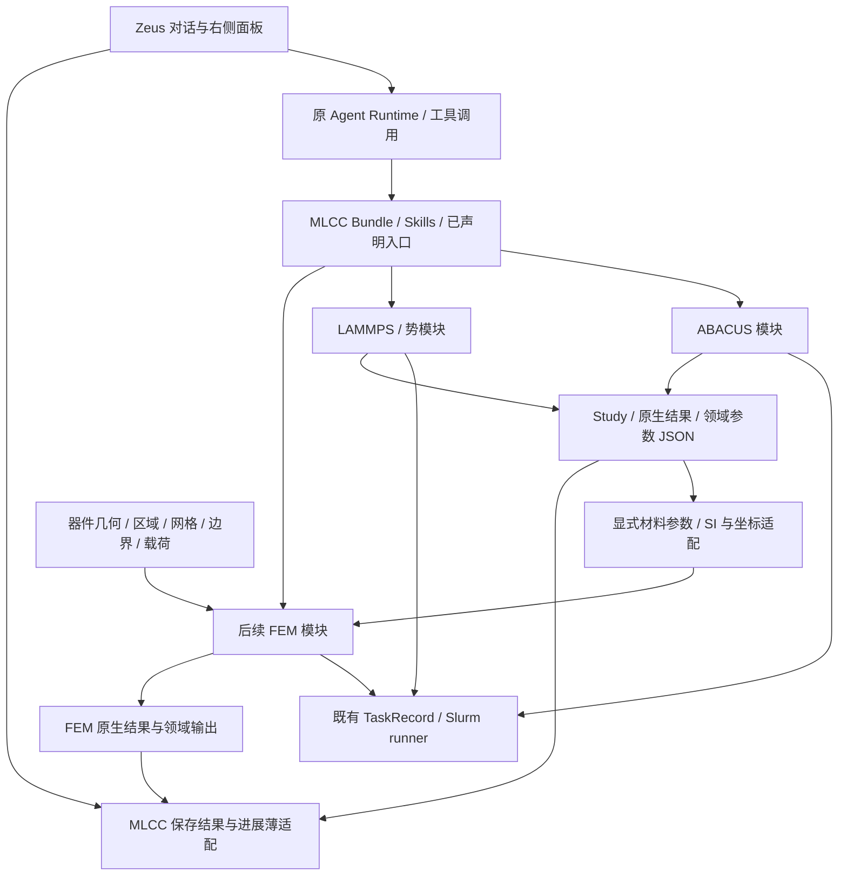

# MLCC 复用 Zeus／光刻胶模板与后续模块接入计划

日期：2026-10-27。状态：保全与增量接入计划；原生对话界面、安装能力绑定、保存数据查看及本地 Codex CLI 驱动的真实只读工具闭环已完成；全面领域接线和有限元仍待完成。依据为本地两个参考树、当前 MLCC 0.57、实际验收记录和用户提供的光刻胶网页截图；不据截图推断线上部署与本地源码完全同版。参考树只读，实施位置为 MLCC 私有运行时及独立领域模块。

**用户最新约束：先保全 MLCC 已开发能力，再复用模板。第10节为本计划的迁移前置条件；已建立启用0.57的静态能力基线和逐命令迁移账本。已有能力不得因页面、提示词、工具列表或数据转换而不可达或失真。**

## 0. 当前交付与接下来要做的事

此表优先于下文最初拟定步骤中的时态。每一步只补缺失接线，不重新开发或重复验收已有计算模块。

| 工作 | 当前状态 | 下一动作 |
|---|---|---|
| 科学能力保全 | 0.57启用、0.56回退；107 CLI、4 Skill、7 MCP、25类交付来源及独立势入口已建立静态基线 | 各领域接线时逐项核对参数、结果、入口和原证据；数量相同不能代替行为保全 |
| 原生对话界面 | 原catalog→命名→AgentThread、四Skill绑定、保存数据dialog及返回草稿已验收 | 复用现有界面，不再重画或重做相同浏览器验收 |
| 模型与工具调用 | 本地 Codex CLI ChatGPT 登录、真实模型回答及一次 `mlcc_list_tasks` 只读 MCP 调用已验收；原生 MCP trace 仅暴露 MLCC 工具 | 按逐函数清单接入后续领域入口；不把首个只读调用扩成全量迁移，也不改变原 CLI/Skill/MCP 入口 |
| 领域入口与结果导航 | 原CLI/Python/MCP及Task/Study查看器保留；全面对话迁移未完成 | 依第10.4节逐领域接入，保留原入口；不把首轮只读工具范围当系统总能力 |
| 多人协作与FEM | 已有材料参数/SI/COMSOL文件出口；持久化、多项目关联及FEM原生导入/求解未完成 | 明确模块合同和所有权，先接项目数据与已有参数，再做一个FEM真实闭环 |

实际界面/宿主证据：`workspace/reports/zeus-dialogue-entry-v001/acceptance.json`。能力基线和107行账本是原始静态盘点，`not_started`不能用来否认后来已通过的界面/绑定，也不能因界面通过而批量改成领域调用已验收。已有功能保留、新界面可达、工程调用验收、科学适用性分别记录。

光刻胶截图显示的是`agent.mattok.cn`云端工作台。其外观可以参考，实际模型服务配置是否可访问是另一项部署依赖；源码模板中的endpoint/model或浏览器登录会话不能作为当前服务配置的证据。这项依赖不要求重算任何MLCC任务，也不阻塞独立的数据和模块合同工作。

## 1. 总体选择

**复用 MatterAI 的完整研究工作台；复用光刻胶的能力包装和任务组织方式；保留现有 MLCC 科学内核；用已有领域参数合同接入后续有限元。**

截图中的左侧项目/线程、中央智能体介绍/输入框、右侧文件/研究笔记/子智能体/计算进展，属于 Zeus 宿主。光刻胶能力包负责描述智能体、技能和计算入口。二者分别提供界面和领域能力，不能只复制光刻胶目录就得到完整网页，也不应重新画一套相似页面。

现有 MLCC 查看器继续复用，但由主入口页面调整为对话工作区中的任务/结果视图。用户选择 MLCC 后首先看到与截图一致的对话入口；已有 Task、Study、参数卡和原 JSON 作为其可打开的计算记录。

推荐保持一个面向用户的 MLCC 智能体，内部连接原子建模、电子/缺陷/介电、材料势、MD、材料参数和有限元模块。模块不等于独立账号或独立聊天，不要求每位开发者实现一套前后端。未来只有依赖环境、发布节奏确实独立时，才把某个领域模块封装为单独 Bundle/MCP。

## 2. 当前基线与本轮规划边界

| 对象 | 已有证据 | 下一阶段处理 |
|---|---|---|
| 计算软件 | 0.57 启用冻结，0.56 回退；J1–J6 已完成真实任务到领域 JSON/同 Study 的工程交付 | 接入这些能力，不为网页重写或重算 |
| 计算执行 | TaskRecord、显式任务创建器、七个 MCP 生命周期工具、v100 Slurm | 同一任务只有现有 runner 负责提交、查询和收集 |
| 参数 | `mlcc.domain-parameters.v1` 已有 `properties[]`；部分产品保留领域专用 schema | 新模块优先消费现有合同，专用产品用薄适配，不整体重写旧 JSON |
| 当前网页 | 原认证、项目、MLCC 选择、46 条保存任务、MCP 查询、两个配置 Study/三个参数文件 | 首轮是查看入口；不能当作完整对话驱动计算已验收 |
| 页面布局 | 已修复列表滚动、Task/Study 尺寸，并实际 Edge 验收 | 后续重组时保留滚动约束和现有组件 |
| 会话/项目存储 | 当前开发内存模式，服务重启清空账号/会话/项目元数据 | 多人长期使用前接宿主已有持久化方案；不重建认证 |
| 自然语言计算 | 原生聊天界面、Windows专用工作目录、真实安装能力绑定及一次本地 Codex CLI→模型→`mlcc_list_tasks`调用已通过 | 依第10.4节逐函数接入后续领域入口；保留原 CLI/Python/MCP，不把一次只读调用当作全量迁移 |
| 有限元 | 已有 SI 材料包及 COMSOL Java/CSV 文件出口 | 原生导入、器件几何、网格、边界条件、求解及结果消费仍是新里程碑 |

系统工程链通过后可以继续开发。原来的 null、失败、未收敛和科学适用条件原样随参数传递；不因材料资格尚未完成阻塞无依赖的界面与接口工作，也不把工程通过说成材料精度全部满足。

本计划扩展后续开发路线，不改变现有计算输入，不启动温度矩阵，不重复 577–633 或已有科学验收。有限元首次实际计算在其环境与具体实验请求就绪后实施。

## 3. 具体复用清单

参考根目录：

- `MatterAI-main/MatterAI-main/`：Zeus 宿主。
- `Photoresist-agent-kit-main/Photoresist-agent-kit-main/`：能力包模板。
- `workspace/runtime/matterai/`：MLCC 当前私有宿主，实际改动落点。
- `mlcc-agent/`：MLCC 科学能力源码，当前 0.57 冻结。

| 编号 | 复用对象 | 处理方式 | MLCC 需要改变的内容 | 验收依据 |
|---|---|---|---|---|
| R1 | Zeus `WorkspaceShell`、`ProjectWorkspace` | 沿用现有宿主 | MLCC 选择回到原 Agent/线程路径；保留项目与会话身份 | 在同一项目选择 MLCC，进入对话，原线程可回到同一上下文 |
| R2 | 原聊天区域、介绍卡、输入框、推荐问题 | 复用组件及原运行机制 | MLCC 名称、简介、starters、已安装能力；不把旧 VASP bootstrap 文案继续作为主推荐 | 实际一次提问能经已配置运行时调用真实只读 MLCC 能力，并显示来源 |
| R3 | `WorkspaceInspector` 四个现成页签 | 复用布局、补实际数据接入 | 文件绑定 MLCC 项目；研究笔记当前占位，新增 Study/参数内容；进展接 TaskRecord | 每个已接页签有对应真实状态；未接项和空状态明确，不填假任务 |
| R4 | 当前 `MlccWorkspace`、`ParameterDocument` | 拆出/复用已有视图 | 列表、TaskDetail、StudyDetail、参数卡成为 Inspector 或展开详情；旧查看入口保留过渡期 | 不丢字段、来源、null、历史状态、原始错误；长列表/长详情可滚动 |
| R5 | Bundle v2、Agent/Skill、受控工具声明 | 按模板约定包装 | 仍绑定现有 MLCC 安装版本；所需能力才暴露，站点路径留配置 | 真实宿主读到实际安装版本，工具只调用声明入口 |
| R6 | 光刻胶任务组织和小入口脚本方式 | 复用组织方式 | 材料/计算领域改为 MLCC；命令转接现有函数/CLI/runner | 入口参数与下游请求一致，不另造同功能 runner |
| R7 | 现有领域 JSON、Study、Task 生命周期 | 直接沿用 | 补项目/线程与科学身份的显式关联，以及新增模块登记项 | 前端能从任务定位参数，再定位原生任务/job；身份不互相替代 |
| R8 | 连续材料参数及 COMSOL 出口 | 保留并增量适配 | 新领域包到已有 SI 请求的薄适配，随后接 FEM 模型和执行 | 导出、原生导入、求解、结果消费分别给证据 |

不复制光刻胶专属树脂、PAG、反应/脱保护规则、分子角色和参数默认值；不移植其站点路径、账号、凭据、数据或已有作业。也不把 kit 的 single-agent tester 当成目标 Zeus 产品前端。

本地光刻胶 `bundle.json` 实际为 `mcpServers: []`；`mcp-servers/` 下存在内部 handler 并不代表对外 MCP 已暴露。MLCC 已有七工具不因此改为空，也不另抄一份光刻胶 dispatcher。可借鉴其保存意图、作业收据、明确状态来源和失败保留；已有 MLCC 生命周期继续使用。

首页推荐语使用 MatterAI Agent registry 识别的 `starters`（MLCC 当前 AGENT.md 已有），不是臆造 `starter_prompts`。本地光刻胶 Agent frontmatter 只有 title/description/enabled；截图的示例问题不能据此断言全部来自这个本地文件。

## 4. 前端最终摆放与操作路径

```text
左栏：项目 / 线程 / 智能体矩阵
中央：MLCC 介绍与推荐问题 → 对话 → 任务方案/工具返回/结果摘要
右栏：文件 | 研究笔记 | 子智能体 | 计算进展
                      └ Study、参数卡、来源、原 JSON/展开详情
                                         └ 原生 job、保存状态、查询时间、失败原因
```

### 4.1 主页内容

名称采用“MLCC 多尺度计算智能体”。简介覆盖原子模型、ABACUS、势与 LAMMPS、参数交付；有限元明确标成待接入模块，接通前不宣传可以完成器件求解。

推荐问题从能力配置读取，首批建议：

1. 查看这个 Study 的计算任务和已有参数。
2. 比较已有 CaZrO₃ 与 BaTiO₃ 结果，并列出不可直接比较的条件。
3. 为已选结构规划 ABACUS 或 LAMMPS 任务，列出所需输入。
4. 整理可交给有限元的材料参数和缺项。

这些是入口提示，不是自动执行任务或新增材料参数的授权。真正创建计算时仍走现有显式参数与任务生命周期，缺输入时显示具体缺项。

### 4.2 四个右侧页签

| 页签 | 第一版显示 | 重要语义 |
|---|---|---|
| 文件 | 当前项目/Agent 的结构、请求、参数包、报告与原生文件引用 | 区分本地副本和远端位置；不把所有科学目录复制进网页工作区 |
| 研究笔记 | 本地上游目前是空占位，第一版接已有 Study 与参数入口，详情复用 `ParameterDocument` | 这是需要补的展示内容；独立富文本笔记/持久编辑不作为本轮前置。浏览器不做科学后处理 |
| 子智能体 | 宿主真实委派和结果 | 当前是运行内临时事件，刷新/切换后不持久；开发团队成员和求解器进程不自动成为运行时子智能体 |
| 计算进展 | 本项目绑定的 ABACUS/LAMMPS/FEM 任务，执行阶段、原生 job、查询/保存时间 | 调度完成、电子/离子收敛、参数可用和设计判断分别展示；没有原生进度则不显示推算百分比 |

长任务表和长 JSON 可展开到宽详情，右侧保留列表与选中项；避免将复杂参数硬挤进窄栏。布局优先沿用原组件的尺寸和样式变量，局部 CSS 不覆盖全局按钮或复选框。

### 4.3 已纠正的入口与继续保留的边界

- 最初 `MlccAgentCatalog` 曾直接返回 `MlccWorkspace`，绕过原目录 `onSelectAgent`。原Agent选择/命名/线程流程现已接回，保存数据改为可关闭的辅助dialog，返回不丢草稿。复用此实际交付，不再次改写同一路由。
- 当前 `/api/mlcc` 是显式文件清单与 list/query 查看接口。保留它为来源读取和进展适配，不把浏览器变成任意 Python/shell 执行端；计算动作由宿主工具/能力入口调用已装 MLCC。

### 4.4 计算进展采用宿主已有正式协议

MatterAI 已有可选 Bundle `taskProgress` 声明：`schemaVersion= matterai.task-progress.v1`、`runtime=python|node`、Bundle 内 `entry`，可选 `resultEntry`。有效声明才产生 `compute-progress` 能力；不能手填 `capabilities` 把未接功能点亮。当前 MLCC 0.57 尚无此声明，需在真正实施此入口时进入能力包新候选，并只验收这条新增接线。

进度出口返回 `{schemaVersion,tasks}`；任务采用 `taskId/kind/status/updatedAt/stateSource`，按实际需要附 phase、operationId、outcome/reasonCode 等。`stateSource` 明确为 `saved-journal` 或 `live-scheduler`；原生 job ID 和详细数值状态仍保留在 TaskRecord/详情中，不强塞入不支持的 DTO 字段。

原 `ComputeProgressPanel` 每5秒调用宿主 `listComputeTasks`，不直接调用引擎。MLCC 的该读取路径只读保存投影，用户明确查询时才调用现有 query；不让页面轮询变成每5秒 `scontrol`。没有原生总步数的 DFT 不构造完成百分比。真实查询错误不覆盖历史原生终态。

现成 client 类型还要求 `shareComputeTask/revokeComputeTaskReader`，UI 则依据 `canShare` 才显示这些操作。首轮只做项目内查看，`canShare=false`：优先使用宿主已有真实 client/授权服务；若本地接线无法满足，则在私有面板把共享能力显式设为可选，只复用现有列表展示。不得用空成功函数冒充共享，也不为这一页新增一整套共享系统。计算进展何时启用以该实际读取路径通过为准，聊天和保存数据页无需等待此项。

## 5. 后续开发者的最小接入合同

### 5.1 复用现有层次



以上是依赖关系，不是要求每个请求必经 ABACUS→MD→FEM。某个 FEM 请求可直接使用已有介电参数；另一个可以只用已有热学/弹性包。需要均匀化或本构拟合时，它是一个有输入和证据的独立步骤，不能藏在前端或参数重命名中。

### 5.2 模块登记：只补一个显式清单

首次后续模块接入时建立小型静态登记表，字段建议如下。它是新增合同提案，当前没有自动插件发现能力。

| 字段 | 用途 |
|---|---|
| `module_id`、`title`、`owner` | 稳定标识、用户名称、交接责任 |
| `operations` | 模块提供哪些具体动作；每个动作对应已审阅的函数/CLI/工具 |
| `input_schemas`、`output_schemas` | 支持的领域 schema 及主版本、具名输入 role |
| `required_inputs` | 必要结构/参数/模型/工况引用，缺失时直接报告 |
| `execution_kind` | 保存数据读取、数值后处理、原生求解三者分开 |
| `site_capability` | 必要引擎/环境/许可证，配置引用，不写凭据 |
| `backend_id/version`、`site_config_ref` | 实际后端版本及站点配置引用；未核实的安装或许可证明确待核，不从模板推定 |
| `display_kind` | 复用参数表、标量、张量、曲线、文件或任务详情等已有 renderer |
| `implementation_state` | 规划中、已实现待接入、已工程验收；区别于某次任务执行状态 |

登记表只分派到代码中明确导入的函数/受控命令；不从上传 JSON 动态 import 模块、执行任意 shell 或扫描全盘寻找插件。已有 CLI/MCP 保留；只有新模块确实需要对外工具时才新增具名工具及 allowlist。

### 5.3 数据合同：以已实现 v1 为准

已有公共产物不是待开发设计：`domain_parameters.py:domain_parameter_product` 输出：

```text
schema = mlcc.domain-parameters.v1
kind / model / study / properties[] / execution
```

每个属性采用现有 `name`、`value` 或 `data_ref`、`unit`、`shape`、`definition`、`conditions`、`coordinates`、`atom_mapping_ref`、`source_refs`、`status`。`properties` 是列表，不按旧提案擅自改为对象。大数组继续引用原文件。

新模块必须交清楚：

1. 支持哪些输入 schema/主版本，哪些量是必须项，哪些可以缺失。
2. 模型、Study、方法和工况绑定；同名参数不代表可互换。
3. 单位、张量分量次序、坐标系、参考态及可用范围；转换只在指定适配器做一次。
4. 保存原生任务/job/文件、状态与理由；null 与零不同，失败与没有执行不同。
5. 输出给哪个 Study 和 artifact；参数交付不重读原生或重新拟合已有结果。

新的 FEM 原生领域结果可以有自己的 schema；只有导出的具名物性/汇总需要进入公共参数结构。网格与场文件不强行塞进原子模型或 DFT Result。

模块登记表属于 MLCC 的内部集成配置，不能向 MatterAI Bundle v2 凭空添加未支持的 `modules` 根字段。对宿主仍通过原 Agent/Skills、明确脚本/MCP 和 taskProgress 等正式扩展点提供能力。

### 5.4 三类身份必须分开

- Zeus：用户/项目/线程/Agent run 身份，管界面与访问权限。
- MLCC：Study/model/version/task/artifact 身份，管计算来源与产物。
- 调度器：site/job ID，管实际执行。

用显式关联记录把三者连接，一个线程可查看多个 Study，一个 Study 可包含多任务。任务名称或目录“最近修改时间”不能代替这些关系。后端按宿主的项目授权解析引用，不继续把当前全局演示清单当多项目数据隔离机制。

当前 `sources.json` 的两个 Study/三个参数可作为首个映射样本，逐项转成显式登记；不全盘扫描旧报告、不搬迁历史科学目录。保存快照与实时查询分别记录，网页历史 job20 的失败证据复用，不为验收反复查询已消失作业。

### 5.5 开发者交付件

每个模块交付六件即可：模块说明与责任人、具名请求合同、实际函数/CLI入口、领域结果与公共参数出口、一个真实或明确工程样本及原证据引用、针对本次新增路径的验收记录。附依赖/资源配置和具体未完成项。

新领域开发者负责自己的模块与专测；公共 CLI、Bundle、宿主路由和登记表由集成负责人串行接线。需要新 UI 时提交最小 renderer，不修改全局 CSS 或另起前端。schema 破坏性改变必须升主版本并显式适配；不批量重写已验收 v1 产物。

## 6. 有限元接入需要交什么

第一目标沿用已有 COMSOL 方向。是否可运行以目标环境、实际安装版本和许可证为准；本地报告中的 COMSOL 文档版本不是服务器安装证据。其他求解器以后复用同一材料/器件边界，另加目标适配器。

现有 SI 实现仍含 `comsol_global_cartesian` 等目标约定，并非已经完全求解器无关。首个 COMSOL 接入不先做全面重构；真正增加第二个 FEM 后端时，再将必要目标名称/映射移到适配器，显式兼容已有 v1，不悄悄改变坐标语义。

| 边界 | 已有或新增 | FEM 开发者接收/负责 |
|---|---|---|
| 原子域物性 | 已有领域 JSON 和专用产品 | 接收明确选择的 ε、C、ρ、热容、热膨胀、导热或界面产品；不要求读取 ABACUS/LAMMPS 日志 |
| 连续材料包 | 已有 `build_continuum_parameter_package` | 复用 SI、坐标、来源；新领域 JSON 如尚不被 `_extract_source` 接受，只加所需薄适配 |
| 目标格式 | 已有 `export_comsol_material_package` | 复用 Java/CSV 与映射记录；原生导入另验收 |
| 器件模型 | 新增独立合同 | 几何引用、单位、区域/材料赋值、层厚、电极/端头、界面、坐标；不从原胞猜器件尺寸 |
| 网格与物理 | 新增独立合同 | mesh、region/selection ID、物理接口、边界、载荷、初值、求解设置与停止条件 |
| 实际执行 | 复用 runner，新增求解器创建器/解析 | prepare/transfer/submit/query/collect；原生命令、原生 job 与错误；无静默换引擎 |
| 输出 | 新增 FEM 领域结果、复用展示入口 | 原生模型/解文件、场文件引用、区域/节点/单元映射、汇总量及单位、收敛/失败与来源 |

有限元请求至少要能表达 `study_ref`、`material_package_refs`、`geometry_ref`、`region_material_assignments`、`mesh_spec`、`physics`、`boundary_conditions`、`loads`、`solver_spec`、输出选择和 site/resources。以上为待实施字段语义，不是已有 API。

FEM 场文件使用节点/单元/区域身份；`atom_mapping_ref` 在不适用时明确为空。若做原子区域到连续场的映射，另声明源/目标坐标、空间平均、体积/面积、映射规则和验证依据，不用逐原子 virial 直接填网格应力。

首个验收任务选择**一套几何、一个物理问题、一个明确载荷**。从材料包原生读入到一次求解、原生输出、Study/页面消费走完即可；不同时开发整机多物理场、裂纹/相场、非线性滞回和工艺全历史。

已有材料参数的科学限制不阻塞接口展示和工程导入。真实求解需要该问题所需输入齐全；若缺必要介电/本构/边界，不自动补典型值。可以使用另一个已明确选定且输入就绪的工程问题推进，具体模型在该里程碑开始时确定。

器件输出同时容纳正常设计响应与劣化场景，例如电容/电场、温度、位移/应力，以及后续明确模型的损伤指标。设计需求是可选独立输入；用户当前搭建普适系统，未给合格线时仅交响应和条件，`design_assessment` 保持未评估，不把“没有劣化”自动判为设计合格。

## 7. 分阶段执行与文件所有权

阶段按依赖推进，不设置原已撤销的24小时截止；表中的验收是新增路径，不要求整套重跑。

| 阶段 | 具体工作 | 独占责任/主要落点 | 完成标准 |
|---|---|---|---|
| A：接回原主页 | 将 MLCC catalog 选择接回原 Agent/线程；复用介绍/输入框/推荐问题；保持已验收查看器可访问 | 前端负责人：私有 `apps/web/src/projects`、`workspace`、`mlcc`；宿主选择语义由集成负责人审定 | 实际选中 MLCC 可进入截图式三栏工作台，切换线程及已接页签正常；未接进度不冒称启用 |
| B：对话最小链 | 核模型服务配置与实际运行目录；原 Runtime 加载已装 MLCC，完成一次读取已有任务/参数的对话工具调用 | 集成负责人：配置/启动、server主入口、宿主runtime；领域包仅确有缺口时改新候选 | 对话回复有真实工具与来源；没有配置时明确不可运行，不能静态冒充 |
| C：项目数据与进展 | 任务/Study/产物显式绑定项目；把当前查看器接进 Inspector；薄适配既有计算进展 | 后端负责人：私有 `apps/server/src/mlcc`；前端负责人消费契约；共享类型由集成负责人串行 | 同一Study能贯穿任务→参数→原来源；保存/实时/失败不混；刷新保留选择 |
| D：模块接口与交接 | 固定上述最小登记、请求/结果约定；以一个现有 ABACUS 产品和一个现有 MD 产品接入展示，交付 FEM 开发者说明 | 领域负责人：独立 adapter/合同；集成负责人：公共登记/CLI/Bundle | 新模块按合同登记可被相同页面消费；不改既有解析器，不重算来源 |
| E：长期协作基础 | 复用 Zeus 已有持久化，使账号、项目、线程和模块关联服务重启后保留；使用现有项目授权 | 宿主/部署负责人，数据库/迁移等共享文件独占 | 一次重启后项目/线程/关联仍在；不同项目来源不串用。无需引入新账号体系 |
| F：首个 FEM 闭环 | COMSOL环境→真实材料读入→单一器件工程任务→原生求解→字段/单位/来源消费→同一工作台 | FEM 开发者独占新模块和专测；集成负责人审资源/runner/最终集成 | 四份证据分别标导出、原生导入、求解终态、下游消费；实际job可追溯 |

A、C 的独立视图与后端可以在合同确定后并行；B 的宿主运行依赖单独定位。D 可与 A/C 并行，F 的接口开发可在 D 后开始，真实求解等待环境/输入。E 是多人长期使用前条件，不阻塞本地界面接线，但不能把开发内存模式当持久协作交付。

当前三个既有窗口可按“主线集成／后端与模块交接／前端复用”分工，清晰独立的适配与文档工作交 Luna。后续人工开发者领一个领域目录及合同，不共享修改 `cli.py`、`mcp_server.py`、`ProjectWorkspace.tsx`、server主入口、根package/lockfile。分配前先核当前所有权；本文件是分工建议，不代表已经向窗口派工。

## 8. 验收与发布

页面第一条验收复用保存证据：登录→选 MLCC→对话读已有数据→右侧定位任务/Study→看参数与源→切换页签及滚动。已有查询错误可由记录展示，不重新制造失败，不提新 DFT/MD 只为亮起进度条。

只有改变的路径才补检查：模型工具链检查真实工具返回；项目绑定检查跨项目不串用；新增领域适配检查单位/坐标/来源/状态；FEM 首次求解保留真实原生证据。一个协议的结果可供多项展示复用，工程 fixture 不改写科学资格。

浏览器、TypeScript、宿主构建和连接检查可在本地；所有数值计算、建模、单位/张量等科学后处理与数值验收仍在 v100 经 Slurm。支持 GPU 的计算优先 GPU；全部实际 DFT 继续 `time=0`、新增 SCF `1e-11`，按原生收敛判定，不自动重试/调参。未来 FEM 不承诺所有求解器都支持 GPU，资源按实际引擎能力配置。

宿主网页与科学 Bundle 分开记录版本。本次规划、后续纯网页改动不自动升 MLCC 0.57；确需改变便携能力包时建立新候选，审收后启用。0.57/0.56及原生科学证据继续保留，参考树始终只读，不提交 Git。

下一项沿用已通过的界面/绑定，按第10节的领域提示、数据保全和C/D独占接口逐函数接入；不重复模型调用验收。旧查看器保留可访问入口，直至对应新入口实际接通；已有CLI/Python/MCP持续可用。先让现有能力在原 Zeus 对话工作台可用，再接 FEM。不以重复发布或反复科学验收代替这条用户可操作的闭环。

## 9. 本地依据

以下路径与函数经过只读调查；未运行模板测试、科学计算或线上光刻胶实例。

| 模板 | 精确位置 | 用途 |
|---|---|---|
| MatterAI | `apps/web/src/workspace/WorkspaceShell.tsx:152,645` | 三栏 props、中央 children 和右侧 inspector |
| MatterAI | `apps/web/src/workspace/WorkspaceInspector.tsx:16,28,122,147` | 四标签、compute接线、笔记占位、临时子智能体 |
| MatterAI | `apps/web/src/projects/ProjectWorkspace.tsx:901,924,1248` | `openAgentNaming/confirmAgentName` 到 `AgentThread` |
| MatterAI | `apps/web/src/agent/AgentThread.tsx:1011,1197` | `agentClient.startRun` 与中央 Composer/Transcript |
| MatterAI | `packages/ui/src/agent-catalog/AgentCatalogGrid.tsx:218` | `onSelectAgent(agentName)` |
| MatterAI | `apps/web/src/projects/ProjectFilesPanel.tsx:95,134,416` | 项目/Agent作用域文件入口 |
| MatterAI | `packages/ui/src/compute-progress/ComputeProgressPanel.tsx:11,33,139,372` | 进度client、5秒读取、共享能力显示条件 |
| MatterAI | `packages/shared-types/src/task-progress.ts:24,55,77` | 正式声明和任务进度DTO |
| MatterAI | `packages/core-engine/src/bundles/bundle-registry.ts:335,602` | taskProgress声明及入口文件检查 |
| 光刻胶 | `bundles/arf-car-computation/bundle.json:2`；`agents/arf-car-computation/AGENT.md:1,34`（后者相对该Bundle） | 实际Bundle字段、空MCP列表、preflight/显式execute/source引用约束 |
| 光刻胶 | `docs/agent-bundle-spec.md:3,44`；`schemas/bundle.schema.json:7,50,214` | Tool→Skill→Agent→Harness→Bundle及正式schema |
| 光刻胶 | `bundles/arf-car-computation/mcp-servers/arf_calculation_tasks.py:115,224` | 任务公开结果和原失败/提交状态保留 |
| 光刻胶 | `bundles/arf-car-computation/mcp-servers/arf_md_tasks.py:237,524` | 日志/进度的保存与实时区分 |
| 光刻胶 | `bundles/arf-car-computation/mcp-servers/arf_core.py:683,1001` | `ArtifactStore`与产物引用；借鉴边界，不替换MLCC已有源合同 |
| 光刻胶 | `bundles/arf-car-computation/mcp-servers/arf_jobs.py:557,610,726,938` | 收据、Slurm查询、收集的时序参考 |
| 光刻胶 | `docs/artifact-protocol.md:8`；`apps/single-agent-tester/` | 产物描述及开发测试UI边界 |

- `workspace/reports/domain-json-stage-completion-v001/report.md`：J1–J6 工程边界。
- `workspace/reports/zeus-web-entry-v001/acceptance.json`：网页已验收范围与未验收运行依赖。
- `workspace/reports/zeus-web-entry-v001/layout-fix-20261027/edge-layout-check.json`：布局实际证据。
- `workspace/runtime/matterai/apps/web/src/mlcc/MlccAgentCatalog.tsx`：MLCC目录接入；原选择拦截已修复。
- `workspace/reports/zeus-dialogue-entry-v001/acceptance.json`：原生聊天界面/宿主绑定、保存数据dialog通过，实际模型调用仍pending。
- `workspace/runtime/matterai/apps/web/src/mlcc/MlccWorkspace.tsx`、`ParameterDocument.tsx`：可复用的现有查看器。
- `workspace/runtime/matterai/apps/server/src/mlcc/handler.ts`、`catalog.ts`、`sources.json`：实际 API 与显式源配置。
- `workspace/runtime/matterai/apps/server/src/index.ts`：原认证、内存/持久化分支、runtime/compute服务。
- `mlcc-agent/src/mlcc/domain_parameters.py`、`saved_domain_parameters.py`、`abacus_domain_parameters.py`：已实现的参数合同和来源桥。
- `mlcc-agent/src/mlcc/tasks.py`、`site_runner.py`、`studies.py`、`property_delivery.py`：既有身份/执行/交付。
- `mlcc-agent/src/mlcc/continuum_parameters.py`、`comsol_export.py`：现有 SI 与 COMSOL 边界。
- `docs/modular-stage-handoff-v001.md`：先前模块化评估；其中参数对象示意已由后续实际 `properties[]` 合同替代，不能反向改坏现有 v1。
- `docs/multi-dopant-and-continuum-roadmap-20261026.md`：连续参数与真实求解的边界。

## 10. 能力保全优先的迁移执行方案

### 10.1 已建立的基线

本轮从**实际启用的安装包** `workspace/.zeus/bundles/mlcc-agent/0.57.0/` 静态读取入口，未导入或运行任何 MLCC 模块：

| 基线项 | 数量/内容 | 用途 |
|---|---|---|
| CLI | 107个显式命令，含源码中具名循环注册项 | 每个旧入口都有迁移记录，不能只保留当前网页的list/query |
| `deliver-properties` | 25个具名来源选项 | 防止新界面只接少数参数而遗漏原Study交付类型 |
| Skill | 4个：模型、DFT、物性、MD | 保留完整能力组织与约束，不被光刻胶技能覆盖 |
| MCP | 7个任务生命周期工具 | 保留prepare/transfer/submit/query/cancel/collect及list；网页当前只用其中2个并不表示系统只有2个 |
| 独立领域入口 | `python -m mlcc.ceramic_potential_route --request ...` | 保留自训练势显式路线，不能只盘点主CLI而遗漏 |
| Python文件 | 安装包`src/mlcc`下109个`.py`文件 | 源码保留范围提示，不等于109项科学能力全部完成 |
| 原版本与数据 | 0.57启用、0.56回退；原Models/Tasks/Study/参数/报告/原生输出 | 不移动科学目录来迁就新网页 |

基线文件：[mlcc-capability-preservation-baseline-20261027.json](../plans/mlcc-capability-preservation-baseline-20261027.json)。

逐命令账本：[mlcc-capability-migration-20261027.csv](../plans/mlcc-capability-migration-20261027.csv)，107行分别记录旧入口、保留入口、声明位置、参数/结果合同、新宿主接线状态和审阅人。初始领域调用接线状态均为`not_started`；后来的共同宿主绑定证据见第0节，不据此将107条领域调用批量标通过。静态存在不证明已接入新聊天，也不授予科学资格。后续更新这份账本，不另起一份同义能力目录。

命令数量是防漏目录，不是充分验收：命令的参数、行为、原函数入口、失败条件、输出与Skill可达性也必须保留。新增入口允许增加，旧能力不能靠同名空函数充数。

107行中的泛化合同只是初始索引。实施到某一领域时，在原账本补该行的领域族、实际函数/模块、原报告引用、新入口可达性及失败状态保留证据；只回填本次接通的行。25项交付选项、四Skill、七MCP和独立势入口同时按基线交叉核对，不能假设已包含在107个命令名的检查内。第10.2节是覆盖索引，不是这些行为已经全面验收的证明。

### 10.2 按领域保留的能力与边界

以下是迁移覆盖范围，不是重新授予生产资格。代表命令用于定位；完整命令和25项交付选项以基线为准。

| 领域族 | 已有入口/模块代表 | 迁移必须保留 |
|---|---|---|
| 结构、模型谱系 | `import-model`、`derive-supercell`、`derive-defect`、`derive-relaxed-structure` | CIF/POSCAR/extxyz、晶胞/原子ID/父子映射、显式约束；不把未收敛末构型晋升为合格弛豫结构 |
| 晶界与界面模型 | `create-grain-boundary`、`bind-grain-boundary-study`、`create-interface`、`bind-interface-study` | 多父模型、取向、区域、两侧材料、模型与Study绑定 |
| 多组分/随机构型/SQS | `plan-composition`、`compare-compositions`、`plan-configurations`、`import-sqs` | 位点/浓度/seed/组成、外部来源和参考模型；不能在换界面时退回仅支持单一固定材料 |
| ABACUS与方法输入 | `inspect-upf`、`inspect-nao`、`qualify-method`、`create-abacus`、`parse-abacus`、`create-relaxed-scf` | PP/NAO配套、电子数/带电条件、原生解析、PW/LCAO等各路径实际支持范围；不用模板默认覆盖方法 |
| 电子与DFT弹性 | `electronic`、`electronic-dos`、`elastic-plan/calibrate/analyze` | 原生电子数/占据、采样带隙和DOS定义、应力符号/张量/参考态；保留各原生来源与限制 |
| 缺陷热力学与带电链 | `create-neutral-defect-pair`、`neutral-formation`、`chemical-references`、`chemical-potential-region`、`formation-energy`、`binding-energy`、`potential-alignment`、`charge-correction`、`charged-formation`、`charge-transitions` | 同方法host/defect/reference、化学势、VBM/EF、势对齐/介电/修正及缺项；已开发消费者不能因案例输入未齐被隐藏或删除 |
| 铁电/介电与极化响应 | Berry创建/解析、`deliver-polarization`、`polarization-path/energy/strain`、`berry-branch-review/consume`、`born-charges`、`born-affine`、`electronic-dielectric`、`ionic-dielectric`、`dielectric`、`dielectric-modes` | 原始P和量子、明确分支/位移/应变、Born张量、电子/离子/总介电和逐模贡献；CZO已交付值与BTO未决值分别照存 |
| 声子/Γ/NAC | `phonon-plan`、`create-phonon`、`phonon-forces/qpoints/gamma/nac`、`gamma-process` | 位移/力/质量/映射、原始与处理矩阵、Γ平移约定；Γ案例不扩写为已完成有限q/DOS/热导 |
| 磁性与电子输运 | `magnetic`、`transport`及Study交付 | 保留已实现共线消费和τ归一化输运；不把保留入口等同完整磁性/热电生产路线 |
| 材料势两路线 | `create-lammps`/MACE；`ceramic-data/training-bind`、`create-ceramic-training/lammps`、`finalize-ceramic-training`、独立`ceramic_potential_route` | MACE公开候选/对照与ABACUS→DeePMD→LAMMPS独立选择；模型卡、type_map、C++/plugin、元素/原子映射；不静默换势/重训 |
| LAMMPS/NEB/迁移 | `create/parse-lammps`、`create/parse-lammps-neb`、`vacancy-migration` | GPU/Kokkos或DeePMD实际接口、多图像和原生停止原因；NEB图像不是时间，MD没观察跳跃不等于D为零 |
| 界面法/切/热/电与应力 | `interface-normal/tangential/thermal/electrical`、`local-stress`、`thermal-stress`、`md-thermal-sources` | 面积、方向、区域/夹持/载荷、双界面、应力与通量定义；不把胞净量改称单界面量；真实电势源缺失保持未决 |
| 通用MD与统计 | `md-collection/conditions/sources`、`deliver-md`、`md-replicas`及thermo/RDF/MSD内核 | 原生轨迹、unwrap/virial、采样窗、seed、平衡判断、均值/SD/SE/CI和D各自定义；已有未决null与源记录保留 |
| 体热学/弹性与领域JSON | `bulk-thermodynamics`、`bulk-thermal-response`、`lammps-elastic-response`、`bulk-thermal-transport`、`saved-domain-parameters`、`abacus-domain-parameters` | J1–J6的密度/Cv/Cp/膨胀/Cij/热流/梯度/导热及电子等参数，`properties[]`与同Study交付 |
| 设计判断、SI与COMSOL | `assess-design`、`deliver-properties`、`export-continuum`、`export-comsol` | 正常满足设计与劣化均可表达；未给设计指标则未评估；单位/坐标/缺项与导出模板保留，FEM求解仍待新增 |
| 生命周期与续接 | `prepare/transfer/submit/status/query/cancel/collect`、`resume-plan`、`study-plan`、七MCP | v100 Slurm、原生job/终态、显式依赖/命令/收集清单、失败记录、只读续接建议；不换光刻胶dispatcher |

通用MD与聚合物逐函数移植清单继续保留；已经落地的条目按实际能力纳入，新聚合物构建/参数化等未完成项仍是后续队列，不因照搬模板而凭空变成已实现。

主要旧证据直接复用：`domain-json-stage-completion-v001`、`saved-md-parameters-v001/integration-v057`、`multi-dopant-continuum-v001/integration-v050`、`vacancy-migration-v001/integration-v052`、`czo-md-real-sources-v001/integration-v054`、`bto-dy-ho-scf-j6-v001/integration-v056`；P4/P5及势路线沿各自原报告。所有路径均在`workspace/reports/`，不因本迁移重新生成或覆盖。

### 10.3 保全不仅是文件还在

迁移要分别检查四种丢失：

1. **实现丢失**：原函数、CLI选项、Skill或依赖被删除/替换。首轮通过冻结科学包避免此类变化。
2. **入口丢失**：新主页只剩聊天，旧Task/Study查看器没有可点击入口；或模型只能看到list/query而看不到原有领域调用方式。
3. **提示丢失**：旧Agent正文仍宣称早期版本“不支持Born/介电”等，使已交付功能在对话里被误拒绝；或模板提示覆盖MLCC已有路线/物理约定。
4. **信息丢失**：参数显示只留数值，丢单位/条件/来源/坐标/null/失败/原始状态；新scope把已有Study过滤掉或绑定到错误项目。

当前AGENT.md确实混有0.9/0.10历史能力描述，须在下一实际能力包候选中依据最新交付证据整理为“当前支持+具体限制”，历史故障移到历史说明。保留旧失败证据；不能把历史描述简单删除后宣称所有路径都已科学合格。四个Skill逐项链接107命令中对应领域，不用一段泛化的光刻胶提示替换。

首页无需107个按钮。常用任务在推荐问题与领域导航中可发现，其余保留既有Skill/CLI/Python入口；每个能力可定位到操作说明和现有工具。首批只读对话完成时，仅宣称只读接线通过，未接计算动作在账本标待接，不能说全能力迁移完成。

能力浏览应同时标明“原入口可用”“对话已接/待接”和具体输入缺项；不能用一个disabled状态把尚未接聊天、缺案例输入、未通过科学资格三者混为一谈。没有新界面入口的能力仍应给出原操作说明及入口。正常设计响应与劣化场景同样保留，未给设计指标时不自动补阈值。

### 10.4 具体实施顺序

| 步骤 | 行动与交付 | 切换条件 |
|---|---|---|
| P0 静态保全 | 已完成安装包入口基线及107行账本；进一步给领域族绑定原报告，核对实际运行解释器/Bundle来源 | 不删除、不覆盖任何既有能力；对照实际0.57而非只看旧README |
| P1 保留旧入口 | 为当前查看器保留清晰“保存任务与Study”入口；原CLI/MCP/独立路线保持；主卡片准备接原聊天 | 即使provider未就绪，仍能打开原任务/Study/参数页；新旧入口读同一原记录 |
| P2 对话与提示接线 | 原AgentThread、安装Bundle和四Skill接通；更新过期能力描述；先做真实保存数据读取 | 同一请求正确路由到原功能；报告实际来源，未就绪功能明确标待接 |
| P3 分领域接结果 | 按“模型/DFT缺陷介电→势/MD/界面→统计/域参数/SI”依次挂入Inspector与Study导航 | 每族参数、原生状态和来源完整；原始JSON与旧入口仍可访问 |
| P4 进展与项目关联 | 添加正式taskProgress和显式project/thread↔Study/task关系；保存投影读取与用户查询分开 | 不因scope让旧产物消失；不反复scontrol；原失败和历史终态可见 |
| P5 收口 | 更新107行账本、25交付选项和4Skill/7MCP的接入状态；审阅所有新增适配路径 | 所有旧能力有保留入口；新宿主未覆盖项必须明列，不能以总体“完成”遮盖 |
| P6 FEM接入 | 按第6节独立request/result扩展；沿用材料包、runner、Study和展示 | 新FEM可接入且不修改现有原子任务合同；旧能力持续可用 |

P1/P2前端可与P0领域证据整理并行；P3消费者按领域交接，公共入口只有一名集成者修改。P6合同准备可以并行，真实FEM任务不抢占本轮保全/接线范围。

### 10.5 增量验收，避免用重算证明迁移

- **入口清单**：确认107旧命令、25交付来源选项、4Skill、7MCP和独立势路线没有减少。只检查变动涉及的参数/分派，不把107命令全部重新执行。
- **调用与展示**：一条真实只读对话验证共同宿主调用路径；每个新增且不同的产物适配器复用一个已有保存产品，核对本次可能改变的字段/引用。共用适配器复用证据，不逐页面重复计算。
- **错误路径**：用已保存的query失败、未收敛NEB、BTO静态null或缺项记录确认传播；不新造科学失败、不重提历史作业。
- **新增数值转换**：仅当新适配确实做单位/张量等科学处理，才在v100 Slurm补该改变路径的一次检查，保留原生job和终态。纯显示不运行科学后处理。
- **执行动作**：若提交/取消接线确有改变，需要在之后一个已授权、明确的最小任务中证明；本轮没实际执行过的动作保留待验收，不能以按钮/manifest/单测存在代替。原runner不变则复用其已验收证据，不为网页重跑旧DFT/MD。
- **页面与scope**：一次检查原查看入口、新聊天入口、Task→Study→参数→原来源、切换项目/刷新、长列表/长详情和失败显示。无需重复整套认证/API验收。

数值与后处理始终在v100/Slurm；GPU优先、DFT time=0及新增SCF 1e-11等规则保留。工程验收与科学资格、设计判断分列。`null`和未资格不会阻塞无依赖的界面迁移，也不会被新界面改成通过。

### 10.6 回退与多人协作

先将新接线作为独立改动，回退对象是私有`MlccAgentCatalog`/`ProjectWorkspace`路由与必要后端来源适配；保留`MlccWorkspace`、`ParameterDocument`和现有API可用。不覆盖源码树还原，不回滚或删除新产生的科学数据，不取消正常运行的Slurm任务。

若旧入口不可达、数据跨项目串用、单位/状态/来源被改写，先撤回该新增接线并保留失败记录。由集成负责人记录受影响文件、候选/启用/回退位置及原因；回退后只检查受影响的旧入口与同一保存产物，不重做科学计算。正常保留但尚未接入聊天的能力标待接，不因新入口失败而删除原实现。

科学0.57/0.56按当前策略保留；纯UI改动不发科学版本。Agent/Skill/taskProgress确需改变便携包时建立候选，未接受前0.57继续启用。新版本接受后仍只保留当前和前一接受版本，不以迁移为由大量复制软件或清理原生证据。

分工：前端负责人只改工作台/视图；领域负责人只提供原模块调用适配和证据；后端负责人只改项目/文件/进展DTO；主线独占公共CLI/Bundle/Skill清单/路由合同和最终审阅。FEM开发者独占新FEM目录，消费现有材料包，不改旧ABACUS/LAMMPS解析器。各方不得覆盖其他人的改动，变更所有权先交接。

本轮计划复核同步记录了本地 Codex CLI 对话闭环与验收证据；没有修改科学包、原生数据或计算输入，也未提交计算。运行时接线仅限本地 Codex CLI 认证、MCP 工具隔离和对话证据，不改变 0.57 科学能力。后续交付逐项证明“原能力保留，同时获得可追溯的新工作台入口”，不重新开发已经完成的计算模块。


