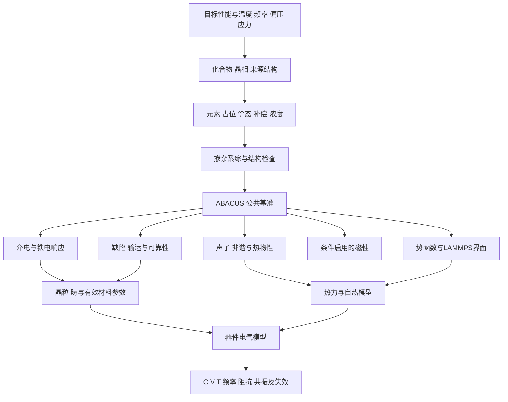

# MLCC 材料 掺杂与器件多链路仿真方案

历史科学论证参考：当前阶段与软件职责以根目录 PLAN.md 为准，P0–P12 已重新编号。先 VASP 接线、再 ABACUS 生产；本文的连续场/完整器件讨论是未来需求背景，不属于当前执行清单。

规划日期：2026 年 10 月 20 日。用户要求保留具体晶相选择，随后通过元素周期表选择掺杂元素；同时规划介电、电气、力学、磁性、声子/导热以及金属界面相容性。既有界面失配、开裂/脱层和聚合物两分支继续保留。

本阶段形成研究与软件规格，未选择最终晶相/掺杂元素，未生成实际晶体、部署 MCP 或提交科学计算。当前两部分执行阶段统一以项目根目录 PLAN.md 的 P0–P12 为准。

## 1 先区分材料和器件目标

C0G/NP0、X7R、X5R、Z5U、Y5V 是电容器的温度特性/性能分类，不能作为晶相名称。材料顺电/铁电属性则与化合物、相、温度、应力和尺度有关。例如 BaTiO3 的立方相是顺电参考，其他常见极性相为铁电；不能仅以化学式把每种相都标成铁电。

厂商的 C0G 实际配方可能是多组分体系。KYOCERA AVX 给出的一个高压 C0G 例子采用 SCZT。纯 CaZrO3 可作为顺电机制基准，不能直接宣称等价于量产 C0G。类似地，纯 BaTiO3 的计算不能证明一款掺杂、多晶 MLCC 达到了 X7R。[厂商说明](https://www.kyocera-avx.com/docs/techinfo/CeramicCapacitors/C0G-High-Voltage-MLCC-in-DCDC-and-OBC-Applications.pdf)

首轮建议各选一个化合物：顺电侧 CaZrO3，铁电侧 BaTiO3。两者都保留用户的相选择步骤；推荐相只作为界面中的建议项。

| 材料/体系 | 常见相或需要指定的状态 | 在本项目中的角色 |
| --- | --- | --- |
| CaZrO3 | 常见非极性 Pnma，No.62；Pbnm 为等价设置之一；高温立方参考需另选 | 首轮顺电机制基准，非 C0G 配方认证 |
| SrZrO3 | 常见非极性 Pnma；高温相需按温度选择 | 锆酸盐扩展候选 |
| MgTiO3 | 钛铁矿型 R-3，No.148 | 温度补偿/微波低损耗材料候选，实际常需复配 |
| BaTiO3 | P4mm、Amm2、R3m 极性相；Pm-3m 顺电相 | 首轮铁电机制及温度相变基准 |
| (Ba,Sr)TiO3 | 先定 Ba/Sr 比例，再选与温压相符的相 | 等价 A 位调相/调温扩展 |
| Ba(Zr,Ti)O3、(Ba,Ca)(Zr,Ti)O3 | 先定组成，允许多相/弛豫行为假设 | 后续多组分候选；不硬编码空间群 |

结构登记必须有来源和胞设置。CaZrO3 的一个可检索结构记录为 [NIST JARVIS JVASP-13829](https://www.ctcms.nist.gov/~knc6/jsmol/JVASP-13829.html)，列出 Pnma、20 原子胞。该记录是候选来源，实际使用仍须取得并核对结构、计算方法、温压背景和晶格。

## 2 用户建模流程

交互顺序为：器件目标 → 材料族 → 化合物/组成 → 晶相与来源结构 → 温压/偏压条件 → 掺杂元素 → 占位与补偿 → 实际浓度/超胞 → 空间分布 → 预览与物理检查 → 导出/派发。

### 相选择

相选项显示空间群号、符号、设置、极性、来源、温压背景和原子数。BTO 至少显示 P4mm(No.99)、Amm2(No.38)、R3m(No.160)、Pm-3m(No.221)。用户若研究高温立方相，应保留它作为高温或受限参考，不能因 0 K 谐声子出现软模就自动删除。

导入后保存 parent CIF、来源路径/版本、晶格基、原子/位点标识和相选择。掺杂后实际对称性常降低到更低群甚至 P1；保存“母相”与“实际弛豫相/对称性”两个字段。全弛豫变相与受限相计算是不同任务，不静默替换。

Pnma 与 Pbnm 的轴变换要同时作用于晶格、坐标、极化和弹性/介电张量，不能只改字符串。空间群校验还要记录容差，避免因微小数值畸变误报相变。

### 元素周期表选择

周期表承担元素输入。选中后展示该母体可能的 A/B/O/间隙占位、价态候选、缺陷配平、PP/ORB 支持、4f/3d 处理及势函数覆盖。元素可以探索，但“可点击”不等于可溶或可以立即计算。

Sr/Ca 可作为 BTO A 位等价取代的起点；稀土 Y/Dy/Ho 等存在占位和补偿问题；Mg/Mn/V/Cr/Mo/W 的价态和位点也不能仅由元素名唯一确定。对首轮模型，可先用 Sr 等价取代验证流程，再让用户决定是否比较 Y 的 A/B 位或更复杂的 Dy/Ho。

| 示例 | 相对晶格电荷 | 一种可能补偿模型 |
| --- | --- | --- |
| Sr 替 Ba，Sr_Ba | 0 | 等价取代 |
| Y3+ 替 Ba2+，Y_Ba | +1 | 电子补偿，或 2Y_Ba 与一个 Ba 空位等模型 |
| Y3+ 替 Ti4+，Y_Ti | -1 | 2Y_Ti 与一个氧空位，或其他物理允许路径 |
| Y 同时替 Ba/Ti | +1 与 -1 | A/B 位成对自补偿 |
| Mg2+ 替 Ti4+ | -2 | 与一个氧空位等候选补偿 |

这里的价态是缺陷模型假设，DFT 的电子与原子数才定义实际计算。尤其不能给 A 位正电供体自动加正电氧空位作补偿。[稀土占位与缺陷研究](https://ceramics.onlinelibrary.wiley.com/doi/10.1111/jace.19168)

对不同成分/缺陷比较形成能时，需要元素化学势、费米能/电荷态、带边对齐和必要的有限尺寸修正。不能比较不同原子数超胞的裸总能来判断哪种配方更稳定。

### 浓度和超胞

显示所选子晶格浓度，不把总原子 at.%、阳离子比例、原料 mol.% 和某位点比例混用。例如基于五原子 BTO 母胞：

| 超胞 | 未掺杂原子数 | 每类 A/B 位数 | 一处替位占该子晶格的比例 |
| --- | --- | --- | --- |
| 2×2×2 | 40 | 8 | 12.5% |
| 3×3×3 | 135 | 27 | 3.7037% |
| 4×4×4 | 320 | 64 | 1.5625% |
| 5×5×5 | 625 | 125 | 0.8% |

这张表只适用于对应五原子母胞；若使用其他相/常规胞，按实际子晶格位点计数。5×5×4 的五原子 BTO 超胞有 100 个 B 位，可放一个掺杂达到 B 位 1%；但一个掺杂不能比较同胞掺杂分散性。若 1% B 位 Y_Ti 还要容纳 2Y_Ti+V_O 中性复合体，需至少 200 个 B 位，约千原子规模，必须在建模前提示成本。

实际建模器求解整数超胞与掺杂数量，返回目标浓度、实际浓度、偏差、原子数、最近周期像距离及估计成本。浓度无法达到时呈现备选方案，不静默四舍五入。

### 分布系综

| 模式 | 表示的假设 | 应记录/比较 |
| --- | --- | --- |
| 最大分散 | 有约束地避免相邻掺杂 | 最小距离、周期像、约束及种子 |
| 无偏随机 | 给定可占位集合上的随机取样 | 多种子、浓度、对分布统计 |
| SQS | 有限周期胞近似指定随机相关函数 | 子晶格、截断、目标相关、残差、多候选 |
| 团簇/缺陷配对 | 相邻掺杂、掺杂-空位复合体可能更稳定 | 距离族、结合能、占位及补偿 |
| 晶界/界面偏聚 | 掺杂可能迁向金属界面或晶界 | 与体相的一致参考、偏聚能、覆盖率 |

初筛可用每一有意义的模型类别 3–5 个独立构型；对临界排序、随机宽分布或稀有事件再增加，而不是声称固定构型数已经统计收敛。合成时的缺陷分布还受动力学冻结影响，室温能量的 Boltzmann 权重不自动代表实际分布。[icet SQS 文档](https://icet.materialsmodeling.org/advanced_topics/sqs_generation.html)

导出的 DFT/MD 原子应为显式整数占位；CIF 中 Ba0.99Y0.01 的统计位点不能直接当作一个原子同时具有两种元素。保存随机种子、明确替位/移除列表和稳定 atom_uid，导出重排时附原子映射。

## 3 六条计算链和公共前置任务

公共前置计算包括材料理论水平、PP/ORB/价电子基准、结构弛豫、能带/缺陷态、独立应变与选定结构的稳定性。一个 model_id/version 绑定母相、组成、补偿、分布、边界和来源路径。各链共享结构与方法记录，不重复生成看似相同但位点不同的模型。

### A 介电和铁电

顺电链关注电子 epsilon_inf、离子响应、各向异性、温度/应力依赖和损耗来源。铁电链进一步需要 Berry 相极化差、不同极化路径/应变的能量、畴壁、有限温度自由能以及场驱动响应。

静态晶体介电响应可区分电子与离子项；器件低频有效介电常数还包含晶界、畴壁、缺陷和微结构贡献。对铁电材料需要小信号微分响应，不能用 P/E 当作所有偏压下的介电常数。

ABACUS 的 Berry 相功能可作为绝缘体系极化参考，需处理极化量子和连续分支。金属/BTO 总超胞通常不满足三维绝缘前提，不能直接对整个金属夹层模型解释 Berry 相为陶瓷体相极化。

能量/力/virial 势不自动提供极化或电场响应。需要 Born 有效电荷近似、单独的极化模型或合格电场依赖势，并明确相应范围。相场动力学系数与损耗/回线频率需校准，不能从任意步长产生实验频率。

有限温度 Landau 自由能由采样/热力学积分/有效哈密顿量或实验约束建立；0 K 双阱不是完整的温度相关 Landau 势。纯 BTO 的相变序列及掺杂/晶粒改变要验证，才可用于 C(T) 或相变应变。

### B 缺陷与电气可靠性

计算稀土 A/B 位竞争、氧空位/阳离子空位复合体的形成与结合能、必要电荷态、迁移势垒和界面偏聚。DFT+U/杂化对局域 3d/4f 及带隙敏感问题需基准，不能把调 U 视为可任意匹配期望性能。

从这些数据构造与温度、氧活度及电场相关的缺陷/输运模型，必要时连接漂移扩散、Poisson、KMC 或相场。氧空位迁移、电子注入和界面势垒改变可能参与退化，但缺陷势垒也不等于完整的寿命模型。

耐压需要局部场、漏电、孔隙/裂纹、电极边缘、历史和统计失效。电子带隙是材料参考，不能用带隙直接输出额定伏数；若研究本征击穿也需要额外电子激发/输运理论及验证。

### C 声子 热膨胀与导热

声子链建议作为两个首轮材料的共同基准：稳定相的谐声子、软模和必要的非解析修正。Phonopy 可从 ABACUS 有限位移力构建二阶力常数，并给出谐振动热容 Cv 等。[官方 ABACUS 接口](https://phonopy.github.io/phonopy/abacus.html)

高温立方 BTO 的 0 K 软模并不直接否定其有限温度存在；需要非谐稳定化或受限参考解释。QHA 在强非谐/虚频区域也不能直接当成可靠的热膨胀算法。Cp 和 Cv 的区别应按采用的方法处理。

完整晶格热导率需要散射/寿命信息：二阶与三阶力常数加 BTE，或经验证的 MD Green–Kubo/NEMD。只有声子色散不能得到可靠的 kappa。[Phono3py](https://phonopy.github.io/phono3py/phono3py-api.html)、[LAMMPS 热导率方法](https://docs.lammps.org/Howto_kappa.html)

MD 中特别检查多体/长程势对应的热流定义和实现，分析长度、时间和经典统计影响。Ni 的总热导率还包含电子贡献；纯经典原子 MD 主要描述晶格，需与电子导热的计算/实验结合。

界面用 NEMD 等提取界面热导/热阻，明确界面数、面积和温度跳跃定义。材料 kappa、界面热阻、孔隙、接触和电极方向共同决定叠层有效导热。

### D 磁性 作为条件分支

铁电极化、铁磁自旋和声子是不同自由度。CaZrO3、常规 BaTiO3 的理想闭壳层参考不需要因“铁电”而启动复杂磁性扫描。Ni 基准仍需合适的磁性处理，过渡金属缺陷、氧空位局域电子或 Dy/Ho 等 4f 体系则按电子结构问题启用自旋/U/SOC。

Y 与 Dy/Ho 的计算难度不等价。若 f 电子冻结在赝势芯内，就不能据此声称预测了该 f 壳层的磁矩、交换或磁各向异性。支持该元素的赝势或通用势，也不等于支持它的全部价态和磁态。

仅当目标涉及磁性对高频损耗、磁电耦合或相稳定性的影响时，扩展磁序、SOC/各向异性及必要自旋动力学；不为每个非磁介质无差别计算磁谱。

### E 界面与制造

母体改变为 CaZrO3 后，原 BaTiO3/Ni 势不因同为 ABO3 而适用；新增 Zr/Ca、掺杂元素、价态或界面环境都需检查势覆盖。先对无掺杂陶瓷/Ni 做取向/终止/registry 和分离/剪切，再研究掺杂的偏聚及热循环。

相容性至少包括化学反应/氧化、界面键合、机械载荷转移、热阻和表面几何。DFT 支持相对稳定性、键合及缺陷；MD 支持重构、滑移、塑性、受限聚合物和热传输；微观/连续模型负责颗粒、流延、排胶、共烧和微米裂纹。

流延表面平整度和光洁度是制造微结构/流变及颗粒尺度量。单个原子平面不能代表流延膜的 Ra/Rq、波纹、孔隙或电极印刷轮廓。可由实验形貌或颗粒/工艺模型给出统计几何，再把 MD 的局部接触/粘结规律传进去。

聚合物继续比较保留层与临时 PVB 两种角色。前者需要可行的低温组装、两侧粘结和介电代价；后者需要排胶后接触、孔隙与残留状态，再进入烧结/失效模型。已有 [界面力学方案](../../simulate-mlcc-interfaces/references/mechanics-workflow.md) 提供分离功、耗散及断裂相场的详细定义。

### F 器件电气与电热耦合

对于相同有效间隙并联的理想叠层，低场近似 C=N epsilon0 epsilon_r A/d；铁电偏压小信号更应写为 Cdiff=N(A/d)(partial D/partial E)。N 是有效陶瓷间隙数，A 是重叠面积，d 是相应状态的实际介质厚度。

同一常规交错电极 MLCC 中，各有效间隙通常承受端电压，不把端电压再除以 N。局部场需计算粗糙度、电极边缘、孔洞和相间介电差异，而非只用 V/d。

对温度系数，几何也参与：d ln C/dT = d ln epsilon_r/dT + d ln A/dT - d ln d/dT（相同模型且 N 不变时）。因此，纯晶体的介电温度系数不是完整的器件 C(T) 等级。

第一阶小信号模型可采用：

\[
Z(\omega)=j\omega L_s+R_{\rm electrode}(\omega,T)
+\frac{1}{G_{\rm leak}+j\omega C^*(\omega,T,V,\sigma)}.
\]

若复电容已含介质损耗，额外电阻不再重复加入同一损耗。低损耗近似下，首个自谐振 fs≈1/(2pi sqrt(Ls C))；Ls 与电极/端头/安装几何有关。声子光学模频率不是 MLCC 的自谐振频率。[Murata 阻抗说明](https://article.murata.com/en-global/article/impedance-esr-frequency-characteristics-in-capacitors)

用 ngspice 等先完成参数电路扫频。需要几何提取/更高频行为时，使用经验证的电磁/准静态求解器，如 openEMS、ElmerFEM；对多层薄介质/薄电极做合理均匀化和分级建模，避免把全部微结构强塞进全波网格。[openEMS](https://docs.openems.de/en/latest/intro.html)、[ElmerFEM](https://github.com/ElmerCSC/elmerfem)

材料和结构的损耗产生热源，热场通过 epsilon(T)、电极电阻、聚合物松弛和热应变反馈电气/机械链。这是电热耦合。用户现在同时明确要求电子热电输运，按新计划 P6 计算 Seebeck、sigma/tau 和 kappa_e/tau；给定散射时间和晶格导热后再汇总实际 ZT。

## 4 一至六十微米厚度的尺度处理

分别登记流延生膜厚度、排胶/烧结后的陶瓷层厚度、金属层厚度及装配/端头几何。缩率/孔隙会改变 d，不能用生膜厚度直接计算成品容量或耐压。

原子层面用周期体相/缺陷胞或几纳米界面提取材料规律；1–60 um 由微结构/相场/有限元模型表达。假设 BTO 晶胞长度约 0.4 nm，仅 1 um 厚度就约 2500 个晶胞，60 um 约 150000 个。1 um 立方体约含 7.8×10^10 个原子，超出本项目 DFT 的尺度。

| 层级 | 实际模型 | 与厚度的联系 |
| --- | --- | --- |
| DFT | 有限周期体相、缺陷和界面胞 | 得到对局部环境适用的本构/能量 |
| MD | 纳米界面、晶界、局部粗糙与聚合物 | 尺寸/速率收敛后传递接触、耗散和热阻 |
| 微结构 | 晶粒、壳核、颗粒、孔隙和电极连续性 | 真实 1–60 um 膜几何及有效物性 |
| 器件 | 有效间隙数、端头、重叠区和安装边界 | pF 至 uF 的容量、伏数、阻抗和自热 |

容量/耐压范围是不同设计的集合，不是要求同一个材料/同一个器件覆盖全部区间。举例 1000 V 在 1 um 上的平均场为 1 GV/m，在 60 um 上约为 16.7 MV/m；这只是几何换算，不代表任何一例耐压可达。

## 5 软件实现与 MS-MCP 对照

建议架构：材料/相库与元素周期表输入 → JSON 模型请求 → 开源结构服务 → 检查/预览 → ABACUS、LAMMPS、连续模型适配器。MCP 只是调用接口，结构算法放在可独立调用的 Python/CLI 核心，便于批量重现和测试。

首选结构核心为 pymatgen/ASE，配合 spglib 的对称分析和 icet 的 SQS/相关函数。Atomsk 可辅助较大晶体、表面和缺陷的 CLI 操作。VESTA 用于晶体/电荷密度检查，OVITO 可作为轨迹分析候选，MS 原生 XSD/Forcite 需求通过独立适配器保留。

拟议 MCP 能力是列材料与相、规划整数超胞、生成掺杂系综、检查电荷/距离/组成/母相、构造界面和导出。这里是本项目接口设计，不宣称这些工具已经在当前会话注册。

建模输出至少有：source.cif、parent.json、configurations/*.cif、explicit_atom_mapping.json、dopant_manifest.json、validation_report.json；ABACUS 导出包含 STRU 和元素资源映射；LAMMPS 导出需随力场选择 atomic/full、电荷/拓扑和 type_map，不能仅有 data 文件就视为可运行。

每次导出都回读，核对元素计数、胞基/PBC、最短距离、位点映射、占位完整性、补偿原子数和质量/电荷。以这些结构不变量判断成功，不能以截图或 GUI 中能打开作为完整正确性证据。

## 6 能力门槛与计算数量控制

### 能力确认

ABACUS 已有 Phonopy 有限位移接口。最新 3.11.0-beta11 文档还出现 DFPT 的 epsilon_inf/Born charge/LO-TO 参数，但 esolver_type=dfpt 同时标记 under development。应对实际安装版本的基组、自旋、赝势与所需响应逐项回验，不将文档新字段视为通用生产能力。[ABACUS 参数文档](https://abacus.deepmodeling.com/en/latest/advanced/input_files/input-main.html)

若某响应需要第二计算后端，作为明确命名的对照分支，记录理论水平匹配和误差。主 ABACUS E/F/virial 训练标签与不同方法数据不静默混合。对 phono3py/BTE 的格式桥也需验证真实力与位移顺序，不能假设 Phonopy 的现成接口覆盖所有三阶任务。

### 分阶段推进

当前阶段以项目根目录 PLAN.md 和 plans/stages.json 为准：P0 建立独立 MatterAI Bundle，P1–P3 完成局域网执行、显式建模和 VASP 闭环，P4 迁移到 ABACUS，P5–P8 为四条性质链，P9–P11 为同源扩胞/合格势与局部 MD，P12 为参数交接和条件性器件估计。微米相场/FEM、完整器件电磁和全电热力反馈不属于本次执行范围。本文此前的编号已全部废止。

初筛不能对每个元素、所有相、每种浓度、所有随机种子同时做全部声子、三阶热导和界面势训练。先比较公共静态/结构和缺陷，再对每族入选代表进行重计算。某性质的失效不自动否定其他已验证性质，但应阻止向该失效路线外推。

任务按可读 model_id/version、方法名和任务条件记录，不采用内容摘要缓存。相/元素/缺陷改变时明确新建对应版本与分支；仅改变层数/重叠面积，可选择有效范围内的已有材料包。执行状态只用 pending/running/done/failed，科学完成范围单独在结果中说明。禁止防御性编程和哈希值校验，不加入自动重试、自动回退或通用恢复框架。

最终按模型/条件给出：epsilon_inf 与静态/有效介电张量、C(T,V,f)、损耗与漏电依据、缺陷/迁移数据、Cij/alpha/kappa/界面热阻、条件启用的磁性量、界面牵引/断裂参数、Z(f)/ESR/ESL/SRF，以及这些量的来源和误差。任何额定耐压或器件等级判断另附规定的测量/统计条件。
